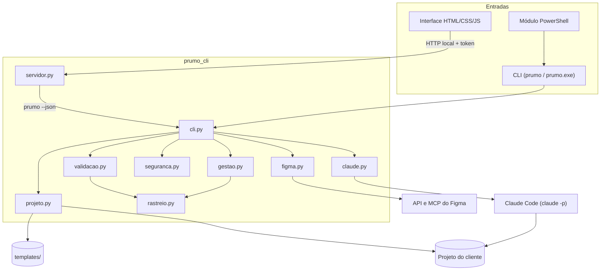

# Arquitetura do Prumo

Para quem vai evoluir o próprio Prumo. Princípios: **só biblioteca padrão do Python**, **tudo em português**, **interface desacoplada** (a GUI só consome `--json`) e **projetos autossuficientes** (cada projeto leva seus hooks e skills; o Prumo não precisa estar instalado para o Claude Code funcionar nele).

## Componentes

| Módulo | Responsabilidade |
|---|---|
| `util.py` | Versão, caminhos (código-fonte × executável), leitura/escrita UTF-8, modelos `{{chave}}`, hash, formatação |
| `projeto.py` | Perfis, criação de projetos, instalação do kit de agentes, geração do `settings.json`, aprovação, ADR/mudança, Figma |
| `rastreio.py` | Parser de IDs (definição × referência por bloco), varredura do código, problemas de cobertura, matriz, estimativas |
| `validacao.py` | Status, validação (aprovados, lacunas, Mermaid leve ou mmdc, rastreabilidade), contexto compacto, extração de diagramas |
| `gestao.py` | Orçamento, horas, exportação para Gemini/Copilot/Cursor |
| `seguranca.py` | Regras da varredura estática e mascaramento de segredos |
| `figma.py` | API REST do Figma: telas, IDs estáveis, preservação da coluna de casos de uso, imagens |
| `claude.py` | Tarefas, prompts, ferramentas por tarefa, execução em `stream-json`, logs, histórico, especificação em etapas |
| `servidor.py` | Servidor local da GUI: token, lista de comandos permitidos, tarefas longas, abrir pasta/arquivo/editor/terminal |
| `cli.py` | Argumentos, saída texto/JSON, projetos recentes, `hook`, `gui`, `_escolher-pasta` |

## Decisões

- **Sem dependências**: facilita o executável e evita quebrar a instalação do usuário.
- **Templates como arquivos**: `templates/` é editável sem mexer em código; `{{chave}}` é o único mecanismo de modelo.
- **IDs em Markdown puro**: a especificação continua legível e versionável; nenhum banco de dados.
- **Hooks em Python sem dependências** e copiados para o projeto: funcionam na máquina de qualquer pessoa que abrir o projeto, mesmo sem o Prumo.
- **`settings.json` gerado programaticamente** a partir de marcadores `HOOK:<nome>`: troca de Python ↔ `prumo.exe` sem duplicar o modelo.
- **Prompt pela entrada padrão** ao chamar o Claude: imune a problemas de aspas no Windows.
- **GUI por cima do `--json`**: qualquer coisa que a interface faz também pode ser feita por script.

## Testes

`python -m unittest discover -s tests -v`. Cobrem: criação de todos os perfis (sem marcadores sobrando, sem IDs órfãos, skills e settings válidos), rastreabilidade, contexto, validação de Mermaid e de aprovados (incluindo CRLF), registros, orçamento, horas, exportação, segurança, Figma (API simulada), todos os hooks (executados como processo, como no Claude Code), ponte com o Claude (com um dublê que emite `stream-json`), CLI JSON e servidor da interface. `tests/powershell.ps1` testa o módulo PowerShell no CI.
