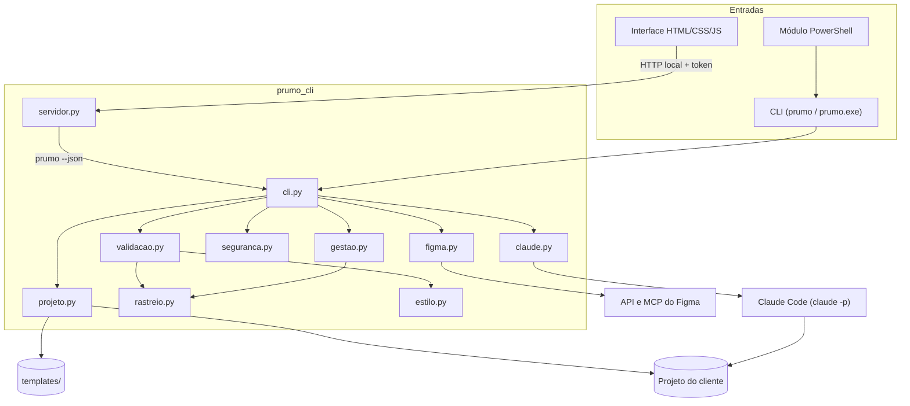

# Arquitetura do Prumo

Para quem vai evoluir o próprio Prumo. Princípios: **só biblioteca padrão do Python**, **tudo em português**, **interface desacoplada** (a GUI só consome `--json`) e **projetos autossuficientes** (cada projeto leva seus hooks e skills; o Prumo não precisa estar instalado para o Claude Code funcionar nele).

## Componentes



| Módulo | Responsabilidade |
|---|---|
| `util.py` | Versão, caminhos (código-fonte × executável), leitura/escrita UTF-8, modelos `{{chave}}`, hash, formatação |
| `projeto.py` | Perfis, criação de projetos, instalação do kit de agentes, geração do `settings.json`, aprovação, ADR/mudança, Figma |
| `rastreio.py` | Parser de IDs (definição × referência por bloco), varredura do código, problemas de cobertura, matriz, estimativas |
| `validacao.py` | Status, validação (aprovados, lacunas, Mermaid leve ou mmdc, rastreabilidade, estilo), contexto compacto, extração de diagramas |
| `estilo.py` | Avisos de concisão dos documentos (enchimento, termos vagos, frases e parágrafos longos, repetição); regras em [guia-de-escrita.md](guia-de-escrita.md) |
| `mapear.py` | Projetos existentes: detecção de stack/comandos/arquivos-chave, `docs/00-mapa-do-codigo.md`, mescla sem sobrescrever (`CLAUDE.md`, `settings.json`); catálogo de ferramentas por linguagem para stacks fora dos perfis |
| `gestao.py` | Orçamento, horas, exportação para Gemini/Copilot/Cursor |
| `seguranca.py` | Regras da varredura estática e mascaramento de segredos |
| `figma.py` | API REST do Figma: telas, IDs estáveis, preservação da coluna de casos de uso, imagens |
| `claude.py` | Tarefas, prompts, ferramentas por tarefa, execução em `stream-json`, logs, histórico, especificação em etapas |
| `servidor.py` | Servidor local da GUI: token, lista de comandos permitidos, tarefas longas, ler e salvar documentos (com proteção de aprovados e de conflito), arquivos estáticos (Mermaid), abrir pasta/arquivo/editor/terminal |
| `cli.py` | Argumentos, saída texto/JSON, projetos recentes, `config` (dados do freelancer e do projeto), `hook`, `gui`, `_escolher-pasta` |

## Decisões

- **Sem dependências**: facilita o executável e evita quebrar a instalação do usuário.
- **Templates como arquivos**: `templates/` é editável sem mexer em código; `{{chave}}` é o único mecanismo de modelo.
- **IDs em Markdown puro**: a especificação continua legível e versionável; nenhum banco de dados.
- **Hooks em Python sem dependências** e copiados para o projeto: funcionam na máquina de qualquer pessoa que abrir o projeto, mesmo sem o Prumo.
- **`settings.json` gerado programaticamente** a partir de marcadores `HOOK:<nome>`: troca de Python ↔ `prumo.exe` sem duplicar o modelo.
- **Prompt pela entrada padrão** ao chamar o Claude: imune a problemas de aspas no Windows.
- **GUI por cima do `--json`**: qualquer coisa que a interface faz também pode ser feita por script.

## Testes

`python -m unittest discover -s tests -v`. Cobrem: criação de todos os perfis (sem marcadores sobrando, sem IDs órfãos, skills e settings válidos), rastreabilidade, contexto, validação de Mermaid e de aprovados (incluindo CRLF), registros, orçamento, horas, exportação, segurança, Figma (API simulada), todos os hooks (executados como processo, como no Claude Code), ponte com o Claude (com um dublê que emite `stream-json`), CLI JSON, servidor da interface (`tests/test_interface.py`: salvar documento, configurações, kit do Claude, arquivos estáticos e a paleta de cores via `tools/cores.py`) e o guarda de privacidade (`tests/test_privacidade.py`, que também confere que o próprio repositório não tem dados pessoais). `tests/powershell.ps1` testa o módulo PowerShell no CI.

## Repositório público e privacidade

O repositório é público (licença MIT), então nada pessoal do autor nem da máquina dele pode entrar em arquivos,
commits, PRs, issues ou releases. O guarda fica em `.githooks/privacidade.py` (só biblioteca padrão, sem rede) e roda:

| Onde | O que verifica |
|---|---|
| `pre-commit` | nome e conteúdo completo dos arquivos preparados e a identidade do commit (login do GitHub e e-mail noreply) |
| `commit-msg` | a mensagem do commit, inclusive linhas com `#` |
| `pre-push` | cada commit, tag e objeto que o remoto de destino ainda não tem (mesmo que outro remoto tenha): autor, committer, mensagem, nomes e conteúdo dos arquivos alterados |
| Hook do Claude Code (`.claude/settings.json`) | bloqueia `--no-verify`, `git commit -n`, `-c core.hooksPath`/`alias.`, variáveis que desligam o guarda, mudanças em `core.hooksPath` e em `.git/hooks`; exige os hooks instalados; varre o que `gh pr/issue/release/gist/repo/api` vai publicar |
| CI | `privacidade.py tudo --historico` com as regras genéricas |

Decisões:
- **Conteúdo completo, não o diff**: cada arquivo alterado é lido inteiro (dois processos `git cat-file` por varredura),
  decodificado em UTF-8, UTF-16, CP1252 ou, em binários, pelo texto legível e pelo de dentro de ZIP (docx/xlsx),
  PDF e PNG; escapes (`\u`, `%XX`, `&...;`) são desfeitos e termos de várias palavras são achados também com
  hífen, sublinhado, sem espaço ou quebrados entre linhas. Assim `-diff`, UTF-16 (o `>` do
  PowerShell 5.1) e linhas enormes não escapam.
- **Hooks fora da árvore versionada**: `instalar` grava hooks pequenos em `.git/hooks` (compartilhado pelos
  worktrees) que chamam o `.githooks/privacidade.py` do checkout atual. Num checkout sem o guarda (um branch
  antigo, por exemplo) eles bloqueiam em vez de liberar em silêncio, o que aconteceria com `core.hooksPath`.
- **Falha fechada**: se o git falhar, o hook bloqueia. Só o hook do Claude libera em caso de erro interno, porque os
  hooks do git continuam valendo.
- **Termos da máquina descobertos na hora**: usuário do sistema, pasta pessoal, nome do computador, pasta do clone,
  e-mails e nome do git, `config/freelancer.json`, pastas de `config/projetos.json` e `~/.prumo/privado.txt`.
  Nada disso fica gravado no repositório. No GitHub Actions eles ficam desligados; `PRUMO_PRIVACIDADE_AMBIENTE=0`
  também desliga (para testes) e o hook avisa.
- **Na dúvida, o hook do Claude confere**: comando com subshell, `popd`, `cd -`, variável ou pasta inexistente conta
  como se fosse neste repositório.

Configuração de cada clone (também na skill `projeto-publico`):

```bash
python .githooks/privacidade.py instalar
git config user.name "<login-do-github>"
git config user.email "<id>+<login-do-github>@users.noreply.github.com"
python .githooks/privacidade.py tudo --historico
```

Falso positivo de regra genérica de conteúdo: `privacidade:ignorar` na linha. Regras de conteúdo e o que fazer se
algo vazar: skill `projeto-publico`.
