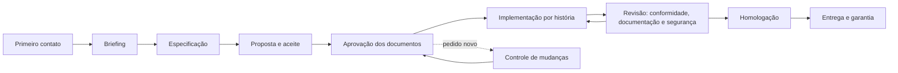

# Fluxo de trabalho freelance

O Prumo organiza um projeto em fases. Cada fase tem documentos, uma skill e comandos de apoio.

## Projeto que já existe

Quando o cliente traz um sistema pronto (manutenção, evolução, projeto herdado), o começo muda:

1. `prumo mapear D:\Projetos\sistema-do-cliente --cliente "Cliente"` (use `--simular` antes, se quiser ver só a detecção). Nada do cliente é sobrescrito; os comandos dos hooks já saem preenchidos.
2. No Claude Code, `/mapear-projeto-existente` (ou `prumo claude mapear`): requisitos, casos de uso, UML, banco e arquitetura descrevem o que existe hoje, cada item com o arquivo de origem; dúvidas viram perguntas ao cliente.
3. Revise e aprove (`prumo aprovar`). A partir daí o fluxo é o mesmo: o que o cliente pede de novo vira história no backlog ou pedido de mudança.

## 1. Primeiro contato e briefing

- `prumo novo` com o perfil mais próximo. Na dúvida, comece com `minimo` e adicione documentos depois (`prumo doc 03-casos-de-uso`).
- Registre tudo em `docs/00-briefing.md`, com as palavras do cliente. Cada reunião ganha uma entrada na seção 10.
- Perguntas em aberto ficam na seção 9. Elas são o roteiro da próxima conversa com o cliente.

## 2. Especificação

| Etapa | Skill | Documento | Pelo terminal |
|---|---|---|---|
| Visão e requisitos | `levantar-requisitos` | 01, 02 | `prumo claude requisitos` |
| Casos de uso | `especificar-casos-de-uso` | 03 | `prumo claude casos-de-uso` |
| UML | `modelar-uml` | 04-uml/* | `prumo claude uml` |
| Interface | `implementar-tela-figma` (inventário) | 05 | `prumo figma telas` |
| Banco de dados | `modelar-banco` | 06 | `prumo claude banco` |
| Arquitetura | `planejar-arquitetura` | 07, adr/ | `prumo claude arquitetura` |
| Backlog | `gerar-backlog` | 08 | `prumo claude backlog` |
| Testes | `planejar-testes` | 09 | `prumo claude testes` |
| Proposta | `proposta-comercial` | 10 | `prumo claude proposta` |

`/especificar-projeto` (Claude Code) ou `prumo claude especificar` rodam todas em sequência. O documento de segurança (12) começa a ser preenchido na arquitetura e cresce a cada revisão.

## 3. Proposta e aceite

`prumo orcamento` soma as estimativas das histórias (`**Estimativa:** 6h`) com a contingência e o valor da hora, gerando `docs/orcamento.md`. A skill `proposta-comercial` monta `docs/10-proposta-comercial.md` em linguagem de cliente, com escopo incluído e excluído, marcos e condições.

## 4. Aprovação

`prumo aprovar <arquivos>` grava data e hash de cada documento aprovado. Daí em diante:

- o hook `guarda_arquivos` impede os agentes de editar esses arquivos;
- `prumo validar` acusa se alguém alterar o arquivo por fora;
- mudanças passam pelo controle de mudanças (fase 7).

## 5. Implementação

Uma história por vez: `/implementar-historia HU-00N` ou `prumo claude implementar HU-00N`. A skill carrega a trilha da história com `prumo contexto`, escreve os testes primeiro (com os IDs `CT-xxx`), implementa citando as regras (`// RN-002`) e sugere o commit `feat(HU-00N): ...`.

Configure os comandos da stack em `projeto.prumo.json` → `comandos` para os hooks formatarem e rodarem o lint a cada edição (veja `comandos_sugeridos`).

## 6. Revisão contínua

- `/revisar-conformidade HU-00N`: código contra especificação, item por item.
- **Mudança significativa** (3+ arquivos de código, 80+ linhas, ou áreas sensíveis como autenticação, banco, rotas, dependências, infraestrutura): o hook `revisao_pos_mudanca` obriga o Claude a rodar `atualizar-documentacao` e `revisar-seguranca` antes de encerrar. Detalhes em [Segurança e mudanças](seguranca-e-mudancas.md).
- `prumo rastreabilidade` mostra requisitos sem caso de uso, casos de uso sem história e histórias sem teste.

## 7. Controle de mudanças

O cliente pediu algo novo depois da aprovação? `prumo mudanca "Pagamento por boleto"` cria `docs/mudancas/CM-00N-...md`. A skill `controle-de-mudancas` faz a análise de impacto (itens afetados, horas, prazo, custo). Com o aceite do cliente: `prumo desaprovar`, atualizar, `prumo aprovar` de novo.

## 8. Homologação e entrega

- Roteiro de homologação em `docs/09-plano-de-testes.md` (seção 4).
- Checklist de entrega em `docs/11-entrega.md`: código, credenciais, domínio, backup, treinamento, início da garantia.
- `prumo seguranca` e `/revisar-seguranca` no projeto inteiro antes da entrega final.
- `prumo horas` mostra o tempo trabalhado registrado pelos hooks, útil para cobrança por hora e para calibrar estimativas futuras.
