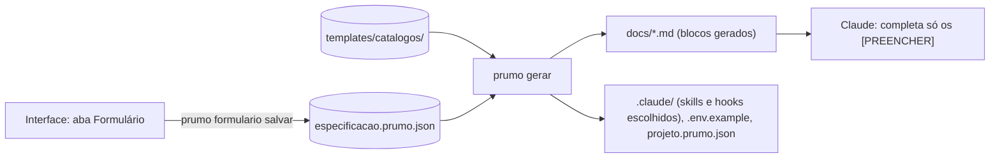

# Formulário de especificação e geração

**Status:** fases 1, 2 e 4 implementadas. Dados e catálogos em `prumo_cli/formulario.py` e `templates/catalogos/`;
`prumo gerar` (`prumo_cli/geracao.py` + `prumo_cli/geradores.py`) preenche todos os blocos da seção 5.2; a aba
**Formulário** tem os passos 1 a 8 da seção 3 mais Perguntas, e a prévia antes de gravar. Ainda são desenho: o passo
Kit (9), a fase 3 (kit derivado) e o status por bloco na aba Documentos.

## Objetivo

Hoje o Prumo cria os documentos a partir dos modelos trocando só `{{projeto}}`, `{{cliente}}` e `{{stack}}`; todo
o resto é `[PREENCHER]` e o Claude escreve. O kit (skills, subagentes e hooks) sai igual em todo projeto.

A proposta: a interface coleta a especificação em campos estruturados, o Prumo **gera de forma determinística**
tudo o que dá para derivar desses campos (tabelas com IDs, diagramas, estimativas, LGPD, superfície de ataque,
configuração dos hooks, skills por integração) e o Claude **só completa o que sobrou**. Os documentos não precisam
sair completos; cada lacuna que o formulário fecha é texto que o Claude não precisa pensar nem escrever.



## 1. Onde ficam os dados

| Arquivo | Conteúdo |
|---|---|
| `especificacao.prumo.json` (novo, na raiz do projeto, versionado) | **O que** o cliente quer: negócio, atores, funcionalidades, entidades, telas, stack, integrações, condições comerciais |
| `projeto.prumo.json` (já existe) | **Como** o Prumo e os agentes se comportam: hooks, comandos, skills incluídas/excluídas, valor da hora, Figma |

Regras:

- **Tudo é opcional**, menos o nome do projeto. Campo vazio = a lacuna `[PREENCHER]` do modelo continua lá.
- **IDs atribuídos ao salvar e nunca renumerados.** Item novo recebe o próximo número livre considerando o formulário
  **e** os documentos (o Claude pode ter criado RF-012 à mão); os exemplos `[PREENCHER...]` dos modelos não contam.
  Apagar um item deixa um buraco na numeração: o campo `ultimo_id` (`{"RF": 9, "UC": 2, "M": 2}`) guarda o maior
  número já usado por prefixo. Linha ainda sem o campo principal (ação, nome, regra) fica sem ID até ser preenchida.
- **Gravar nunca é bloqueado por referência solta** (a interface grava a cada mudança, com o formulário incompleto).
  Só a estrutura impede a gravação: tipo errado, ID inválido ou repetido, versão mais nova que o Prumo.
- **Referências:** por ID para RF, RN, UC e TL; por nome para atores e entidades (a interface propaga renomeações).
  `prumo formulario validar` acusa referência solta.
- Os textos de exemplo usam dados fictícios; nada pessoal vai para o repositório do Prumo.

## 2. Modelo de dados

Exemplo (perfil `web-fullstack`):

```json
{
  "versao": 1,
  "contato": {"nome": "Ana", "email": "contato@exemplo.com", "telefone": ""},
  "negocio": {
    "contexto": "Doceria com venda por encomenda pelo WhatsApp.",
    "problema": {
      "problema": "pedidos anotados à mão",
      "afeta": "a dona e as duas atendentes",
      "impacto": "pedidos perdidos e retrabalho no fim de semana",
      "solucao": "loja on-line com pagamento e painel de pedidos"
    },
    "proposito": "Vender encomendas pela internet e organizar a produção.",
    "objetivos": [{"descricao": "Reduzir pedidos perdidos", "medida": "pedidos sem registro por mês", "meta": "zero"}],
    "referencias": ["https://loja-de-referencia.exemplo"]
  },
  "restricoes": {"prazo": "até março", "orcamento_cliente": "", "tecnologia": "", "legal": ""},
  "atores": [
    {"nome": "Cliente", "tipo": "humano", "descricao": "Compra pelo celular", "dispositivos": ["celular"]},
    {"nome": "Administrador", "tipo": "humano", "descricao": "Dona da loja", "dispositivos": ["computador"]}
  ],
  "funcionalidades": [
    {"id": "RF-001", "acao": "cadastrar produtos com foto e preço", "ator": "Administrador",
     "beneficio": "manter o cardápio atualizado", "grupo": "Catálogo",
     "prioridade": "Must", "tamanho": "M", "origem": "Pedido"},
    {"id": "RF-002", "acao": "pagar o pedido por Pix", "ator": "Cliente", "grupo": "Pedidos",
     "prioridade": "Must", "tamanho": "G", "origem": "Pedido", "regras": ["RN-001"]},
    {"id": "RF-003", "acao": "emitir nota fiscal", "ator": "Administrador",
     "prioridade": "Won't", "origem": "Reunião 10/11"}
  ],
  "fora_do_escopo": ["Aplicativo nativo para lojas de aplicativos"],
  "regras": [{"id": "RN-001", "regra": "Encomendas só com 48h de antecedência", "exemplo": "pedido na segunda, entrega a partir de quarta"}],
  "glossario": [{"termo": "Encomenda", "definicao": "Pedido com data de retirada futura"}],
  "perguntas": [{"pergunta": "Haverá entrega ou só retirada?", "bloqueia": true, "impacta": "RF, estimativa"}],
  "casos_de_uso": [{"id": "UC-001", "nome": "Fazer encomenda", "ator": "Cliente", "requisitos": ["RF-002"], "telas": ["TL-002"]}],
  "entidades": [
    {"nome": "Produto", "descricao": "Item do cardápio",
     "campos": [
       {"nome": "nome", "tipo": "texto", "obrigatorio": true},
       {"nome": "preco", "tipo": "dinheiro", "obrigatorio": true},
       {"nome": "foto", "tipo": "arquivo"}
     ],
     "relacoes": [{"com": "Categoria", "cardinalidade": "N:1", "verbo": "pertence a"}]},
    {"nome": "Cliente", "campos": [
       {"nome": "nome", "tipo": "texto", "obrigatorio": true},
       {"nome": "email", "tipo": "email", "obrigatorio": true, "unico": true},
       {"nome": "telefone", "tipo": "telefone"}
     ]}
  ],
  "interface": {
    "biblioteca": "shadcn/ui", "tipografia": "", "paleta": "", "breakpoints": "",
    "telas": [
      {"id": "TL-001", "nome": "Cardápio", "objetivo": "Mostrar os produtos", "ator": "Cliente", "atende": ["RF-001"], "vai_para": ["TL-002"]},
      {"id": "TL-002", "nome": "Checkout", "objetivo": "Pagar a encomenda", "ator": "Cliente", "atende": ["RF-002"], "vai_para": []}
    ]
  },
  "tecnico": {
    "stack": {"frontend": "nextjs", "backend": "nextjs", "banco": "postgresql", "orm": "prisma",
              "autenticacao": "authjs", "hospedagem": "vercel", "testes": "vitest"},
    "login": "email-senha",
    "perfis_acesso": ["Administrador", "Cliente"],
    "integracoes": ["pagamento-pix", "email-transacional"],
    "rnf": ["responsivo", "acessibilidade-aa"]
  },
  "comercial": {
    "validade_dias": 15, "condicoes": "40% na assinatura, 60% na entrega", "garantia_dias": 30,
    "marcos": [{"id": "M1", "conteudo": "Catálogo e pedidos", "data": "", "percentual": 40}]
  }
}
```

Valor da hora e contingência continuam em `projeto.prumo.json` (`orcamento`). As horas por tamanho ficam em
`config/freelancer.json` (`"tamanhos": {"P": 4, "M": 12, "G": 32}`), porque dependem do ritmo de cada freelancer.

## 3. Passos do formulário

O modal **Novo projeto** continua curto (nome, cliente, pasta, perfil, contato, prazo) e cria o projeto na hora; em
seguida abre a aba **Formulário** do projeto. Assim não existe rascunho fora do projeto, e o formulário pode ser
retomado e alterado a qualquer momento.

| Passo | Campos | Alimenta |
|---|---|---|
| 1. Negócio | contexto, problema (4 campos), propósito, objetivos (descrição, medida, meta), referências, restrições | briefing, visão, proposta |
| 2. Usuários | atores (nome, humano/sistema, descrição, dispositivos), perfis de acesso | visão, casos de uso, arquitetura, segurança |
| 3. Funcionalidades | ação no infinitivo, ator, benefício, grupo, MoSCoW, tamanho P/M/G, origem, regras ligadas; fora do escopo; regras de negócio; glossário | requisitos, backlog, visão, proposta, orçamento |
| 4. Casos de uso | nome, ator, RFs, telas; botão "sugerir um por funcionalidade" | casos de uso |
| 5. Dados | entidades, campos (nome, tipo, obrigatório, único, pessoal), relações (com, cardinalidade, verbo) | banco, diagrama de classes, LGPD |
| 6. Telas (se o perfil tem `05-interface`) | design system, telas (nome, objetivo, ator, atende, vai para), URL do Figma | interface |
| 7. Técnico | stack por camada (listas do catálogo, com "outro"), login, integrações e RNFs (caixas do catálogo) | arquitetura, requisitos, segurança, banco, kit |
| 8. Comercial | validade, condições, garantia, marcos | backlog, proposta |
| 9. Kit | skills (marcadas conforme perfil e respostas), hooks (horas, formatar/lint, testes ao parar, revisão e limites, caminhos sensíveis) | `projeto.prumo.json`, `.claude/` |
| 10. Revisão | prévia do `prumo gerar --simular`: blocos que mudam, IDs criados, lacunas restantes por documento | — |

Perguntas em aberto (P-xx) podem ser digitadas em qualquer passo; os catálogos também sugerem perguntas.

## 4. Catálogos

`templates/catalogos/*.json` guarda as opções das listas e caixas e **tudo o que cada opção implica**. Acrescentar
uma integração ou um RNF é editar JSON, sem mexer em código (mesmo princípio dos modelos).

| Catálogo | Cada entrada traz |
|---|---|
| `integracoes.json` | ator secundário, variáveis de ambiente, RNFs, ameaças e controles, pontos da superfície de ataque, caminhos sensíveis, skills, perguntas para o cliente |
| `rnf.json` | categoria, descrição, métrica; perguntas (ex.: LGPD → quem é o encarregado) |
| `stacks.json` | camada, nome, extensões, comandos `formatar`/`lint`/`testar`, comandos permitidos, permissões do Claude Code, pastas, convenção, variáveis de ambiente |
| `tipos-de-campo.json` | tipo no diagrama ER/classes, se é dado pessoal (e-mail, telefone, CPF, endereço, nascimento) |
| `logins.json` | formas de login (e-mail e senha, link por e-mail, social, SSO), no mesmo formato das integrações |

Cada arquivo é `{"descricao": "...", "itens": [...]}`. Uma tecnologia de `stacks.json` pode servir a mais de uma
camada (`"camadas": ["frontend", "backend"]` no Next.js). O teste `test_catalogos_e_stack_padrao_dos_perfis`
confere o formato depois de cada edição. As skills citadas nas integrações (`integrar-pagamento`...) chegam na fase 3.

Exemplo de integração:

```json
{
  "id": "pagamento-pix",
  "nome": "Pagamento por Pix (gateway)",
  "ator": "Gateway de pagamento",
  "variaveis": ["PIX_CLIENT_ID", "PIX_CLIENT_SECRET", "PIX_WEBHOOK_SECRET"],
  "rnf": [{"categoria": "Segurança", "descricao": "Notificações de pagamento validadas por assinatura",
           "metrica": "notificações sem assinatura válida rejeitadas"}],
  "ameacas": [{"ameaca": "Notificação de pagamento falsificada",
               "controle": "Validar a assinatura e consultar o status na API antes de liberar o pedido"}],
  "superficie": [{"ponto": "Webhook de pagamento", "exposicao": "internet", "autenticacao": "assinatura HMAC"}],
  "caminhos_sensiveis": ["**/pagamento*/**", "**/webhook*/**"],
  "skills": ["integrar-pagamento"],
  "perguntas": [{"pergunta": "Qual gateway o cliente usa ou prefere? As taxas mudam o preço.", "bloqueia": true}]
}
```

Os perfis ganham `stack_padrao` (IDs do `stacks.json`) para pré-marcar o passo 7; o texto `stack` continua
existindo (montado a partir dos nomes) para `{{stack}}` e projetos antigos.

## 5. Geração dos documentos

### 5.1 Blocos gerados

Os modelos em `templates/documentos/` ganham marcadores em volta de cada trecho que o formulário consegue
preencher. Dentro do marcador fica o exemplo atual do modelo, usado quando o formulário não tem dados:

```markdown
<!-- prumo:gerado:rf h=3f9a21c0 -->
| ID | Descrição | Prioridade | Origem |
|---|---|---|---|
| RF-001 | O sistema deve permitir cadastrar produtos com foto e preço (Administrador). | Must | Pedido |
<!-- prumo:gerado:fim -->
```

`h` é o hash do conteúdo **como o Prumo o escreveu**. Ele fica no próprio arquivo: sobrevive a clones e não depende
de nenhum arquivo extra. Nos modelos o marcador vem sem hash (`<!-- prumo:gerado:rf -->`); ao criar o documento
(`prumo novo`, `prumo doc`) o Prumo grava o hash do exemplo (`selar`). Marcador sem hash num projeto conta como editado. O bloco `prumo:figma` do inventário de telas continua como está (seção 5.2).

`prumo gerar`, para cada bloco:

| Situação | O que faz |
|---|---|
| Conteúdo atual bate com `h` (ninguém mexeu) | Reescreve inteiro a partir do formulário |
| Alguém editou (o Claude completou critérios, você ajustou um texto) | Não reescreve. **Acrescenta** os itens do formulário cujo ID ainda não aparece no bloco (linha de tabela de RF, RN e marcos; subseção de UC, HU e tela; a HU conta como presente se o RF dela aparece) |
| Formulário esvaziado (lista apagada) num bloco intocado | Volta o exemplo do modelo |
| Documento aprovado (`prumo aprovar`) | Não toca; mudanças passam por `prumo mudanca` |
| `--sobrescrever <documento>:<bloco>` | Reescreve mesmo editado (a interface pede confirmação mostrando o que se perde) |

Consequência: o formulário manda enquanto o bloco está intocado; depois que o Claude ou você editam, o documento
manda e o formulário só **semeia itens novos**. Lacunas dentro do bloco (critérios de aceite, fluxos) continuam
sendo `[PREENCHER]` normais, que o Claude completa.

Nada muda na rastreabilidade: os blocos seguem as mesmas regras de definição de ID (primeira coluna da tabela,
título `### UC-001 — ...`). O gerador só cita IDs que existem no formulário.

### 5.2 Mapa bloco ← formulário

| Documento | Blocos | Vêm de |
|---|---|---|
| `00-briefing` | `contato`, `contexto`, `problema`, `objetivos`, `usuarios`, `funcionalidades`, `restricoes`, `integracoes`, `referencias`, `perguntas` | negócio, contato, atores, funcionalidades, restrições, integrações; perguntas do formulário e dos catálogos (P-01...) |
| `01-visao` | `proposito`, `problema`, `partes-interessadas`, `capacidades`, `dentro-do-escopo`, `fora-do-escopo`, `restricoes`, `criterios-de-sucesso` | negócio, atores, grupos de funcionalidades, Must/Should, Won't + fora do escopo, objetivos |
| `02-requisitos` | `rf`, `rnf`, `rn`, `glossario` | funcionalidades; RNFs marcados + RNFs das integrações + LGPD automático; regras; glossário |
| `03-casos-de-uso` | `atores`, `diagrama`, `especificacoes` | atores; casos de uso (cabeçalho com ator, RFs, RNs, telas; fluxos ficam `[PREENCHER]`) |
| `04-uml/classes` | `diagrama` | entidades e relações |
| `05-interface` | `design-system`, `navegacao`, `telas`; inventário pelo bloco `prumo:figma` | interface. O inventário usa a mesma função de mesclagem do `prumo figma telas` (casa por ID e nome, preserva a coluna de casos de uso), então formulário e Figma não brigam |
| `06-banco-de-dados` | `cabecalho`, `er`, `dicionario`, `lgpd` | SGBD e ORM do stack; entidades; campos pessoais |
| `07-arquitetura` | `stack`, `integracoes`, `seguranca` | stack, integrações (com tratamento de falhas do catálogo), login e perfis de acesso |
| `08-backlog` | `epicos`, `marcos`, `historias` | grupos → EP-01...; marcos; uma HU por funcionalidade Must/Should/Could |
| `10-proposta-comercial` | `incluido`, `opcionais`, `nao-incluido`, `cronograma`, `condicoes`, `perguntas-valor`, `garantia`; a linha **Validade da proposta** do cabeçalho é preenchida enquanto for lacuna | comercial; Could → opcionais (com horas do tamanho); Won't e fora do escopo → não incluído; perguntas bloqueantes |
| `12-seguranca` | `superficie`, `ameacas` | catálogos das integrações, login, perfis de acesso e telas públicas |

Ficam inteiramente com o Claude: fluxos dos casos de uso, demais diagramas UML, índices e DDL, estrutura de pastas
e módulos, plano de testes, entrega, critérios de aceite e textos de convencimento da proposta.

### 5.3 Regras de texto e derivação

- **Funcionalidade escrita como ação no infinitivo** ("cadastrar produtos com foto e preço"). Daí saem, sem
  problemas de concordância:
  - RF: `O sistema deve permitir {ação} ({ator}).`
  - HU: `**Como** {ator}, **quero** {ação} **para** {benefício | [PREENCHER: benefício]}.`
- **Tamanho → horas** pela tabela `tamanhos` do freelancer: `**Estimativa:** 12h`. Com isso `prumo orcamento`
  funciona logo depois do formulário (o Claude refina depois). Sem tamanho, fica `[PREENCHER]h`.
- **MoSCoW:** Must/Should viram escopo e HU; Could vira HU e opcional na proposta; Won't vai para "fora do escopo"
  na visão e na proposta e não gera HU.
- **Épicos:** cada `grupo` vira um EP, na ordem em que aparece; funcionalidades sem grupo vão para "Funcionalidades
  principais".
- **Entidades → diagramas:** nomes em MAIÚSCULAS sem acento no ER; `1:N` → `||--o{`, `N:1` → `}o--||`, `1:1` →
  `||--||` (FK única), `N:N` → tabela associativa `a_b` com as duas FKs; chave `id` e chaves estrangeiras criadas a
  partir das relações; `unico` → `UK`.
- **IDs só onde existem:** um gerador só cita UC, TL ou marco se o documento que os define existe no projeto.
- **RNF e HU:** RNFs são numerados na ordem (marcados, das integrações, do login, LGPD); HU-00N tem o número do RF-00N.
- **LGPD automática:** campo de tipo pessoal (ou marcado `pessoal`) gera linha na tabela de privacidade do banco
  (finalidade e base legal em `[PREENCHER]`), o RNF de privacidade e a pergunta sobre a base legal.
- **Login:** se houver login e nenhuma entidade de usuário, o gerador acrescenta `Usuario` com e-mail e hash de senha,
  e os RNFs e ameaças de autenticação do catálogo.

## 6. Kit derivado

### 6.1 Quais skills instalar

`templates/agentes/kit.json` substitui o `SKILLS_FIGMA` fixo no código. **Já existe** com as condições `figma` e `perfil:<id>` (usada por `desenvolver-wordpress`); as demais chegam na fase 3. Formato:

```json
{
  "skills": {
    "implementar-tela-figma": "figma",
    "diagramas-figjam": "figma",
    "especificar-interface": "documento:05-interface",
    "modelar-uml": "documento:04-uml/classes",
    "modelar-banco": "documento:06-banco-de-dados",
    "integrar-pagamento": "integracao:pagamento-*",
    "implementar-login": "login"
  }
}
```

Skill fora do `kit.json` é instalada sempre. O passo 9 grava exceções em `projeto.prumo.json`
(`"kit": {"incluir": [...], "excluir": [...]}`). Instalar só o que o projeto usa também economiza: a descrição
de cada skill entra no contexto de toda sessão do Claude Code.

**Linguagem de condição** (a mesma no `kit.json` e nos modelos): `figma`, `login`, `documento:<id>`,
`integracao:<padrão>`, `rnf:<id>`, `stack:<camada>=<id>`, com `!` para negar.

### 6.2 Trechos condicionais nos modelos

`renderizar` ganha um único recurso novo, sem aninhamento: `{{#se <condição>}}...{{/se}}`. Listas continuam
montadas em Python, como `lista_skills` e `lista_documentos` hoje. Exemplo numa skill:

```markdown
{{#se stack:orm=prisma}}Depois de mudar `schema.prisma`, rode `npx prisma migrate dev --name <descrição>`.{{/se}}
```

Os testes continuam garantindo que nenhum `{{...}}` sobra.

### 6.3 Hooks e configuração

| Destino | Vem de |
|---|---|
| `comandos.formatar` / `lint` / `testar` | stack do catálogo, preenchido direto (acaba a cópia manual de `comandos_sugeridos`). Aceita texto ou mapa por extensão (`{".py": "ruff format {arquivo}", ".tsx": "npx prettier --write {arquivo}"}`) para stacks mistas |
| `pos_edicao.py` / `ao_parar.py` | passam a ignorar em silêncio um comando cujo programa não está instalado; por isso dá para preencher os comandos antes de a stack existir |
| `hooks.caminhos_sensiveis` | integrações, login e entidades com dados pessoais |
| `hooks.comandos_permitidos` e `permissions.allow` do `settings.json` | stack do catálogo (menos pedidos de permissão) |
| `.env.example` | variáveis das integrações e da stack, sem valores |
| Skills por integração (`integrar-pagamento`, `enviar-email`, `implementar-login`...) | catálogo; usam `{{#se}}` para os detalhes de cada stack e apontam para os documentos em vez de repetir a especificação |

### 6.4 Regra nas skills de especificação

As skills `levantar-requisitos`, `especificar-casos-de-uso`, `modelar-banco`, `gerar-backlog` etc. ganham a mesma
instrução: *o conteúdo entre `prumo:gerado` veio do formulário e é decisão do usuário; não o reescreva nem o
contradiga; complete os `[PREENCHER]`; se discordar, registre uma pergunta P-xx ou proponha a mudança ao usuário.*
E `prumo claude especificar` pula a etapa cujos documentos já não têm lacunas.

## 7. CLI e interface

| Comando | Faz |
|---|---|
| `prumo formulario [--json]` | Mostra o formulário e os catálogos (a interface usa o `--json`) |
| `prumo formulario salvar <arquivo>` | Valida, atribui IDs e grava `especificacao.prumo.json` |
| `prumo formulario validar` | Referências soltas, IDs repetidos, campos obrigatórios por item |
| `prumo gerar [--simular] [--sobrescrever <doc>:<bloco>] [--sem-kit]` | Gera blocos e kit; `--simular` lista, por bloco: novo, reescrito, itens acrescentados, divergente, aprovado |
| `prumo novo ... --formulario <arquivo>` | Cria o projeto já a partir de um formulário |

O servidor da interface chama o CLI com a entrada padrão fechada, então para salvar ele grava o corpo recebido em
`.prumo/formulario-recebido.json` e chama `prumo formulario salvar` com esse arquivo. `formulario` e `gerar` entram
em `PERMITIDOS` (`servidor.py`).

Na interface:

- Aba **Formulário** com os passos numa coluna lateral e um indicador de preenchimento por passo; listas como tabelas
  editáveis; gravação automática (com atraso curto) a cada mudança.
- Botão **Gerar documentos**: roda `--simular`, mostra o que muda e só então gera.
- Na aba **Documentos**, cada bloco mostra "do formulário" ou "editado no documento".

## 8. Por que isso reduz o "pensar" do Claude

- **Zero tokens** para o que é derivável: IDs, tabelas, diagramas ER, de classes, de casos de uso e de navegação,
  estimativas, LGPD, superfície de ataque, `.env.example`, configuração dos hooks.
- O Claude **não reescreve** o que veio do formulário; só completa lacunas.
- **Menos skills instaladas**, então menos descrições carregadas em toda sessão.
- Etapas sem lacunas são puladas no `prumo claude especificar`.
- Fase 5: o Claude pode **preencher o formulário** a partir das anotações do cliente. Ele devolve um JSON curto e
  validado, você revisa na interface e o gerador expande. Escrever JSON estruturado custa bem menos que escrever
  dez documentos em Markdown.

## 9. Fases de implementação

Cada fase é um PR com testes (`python -m unittest discover -s tests -v`).

1. **Dados e catálogos:** `prumo_cli/formulario.py` (carregar, validar, atribuir IDs), `templates/catalogos/`,
   `stack_padrao` nos perfis, comando `prumo formulario`. Testes: validação, IDs sem colisão com os documentos,
   catálogos bem formados.
2. **Geração:** *feito para todos os documentos da seção 5.2 (o briefing não tem marcadores no modelo: a seção só é
   preenchida se ainda é lacuna; o contato vai na linha da tabela de cabeçalho).* `prumo_cli/geracao.py` (um gerador por bloco, registrados num dicionário), marcadores nos modelos,
   `prumo gerar`, regra nas skills. Começar por `02-requisitos`, `06-banco` + `04-uml/classes` e `08-backlog`, que
   são o maior ganho. Testes: todos os perfis com formulário vazio e com formulário completo; sem IDs órfãos; Mermaid
   válido; gerar duas vezes não muda nada; bloco editado preservado; item novo acrescentado; documento aprovado
   intocado.
3. **Kit derivado:** `kit.json`, linguagem de condição, `{{#se}}`, comandos por extensão e programa ausente nos
   hooks, `.env.example`, `permissions.allow`, primeiras skills de integração.
4. **Interface:** aba Formulário, prévia e status dos blocos. *Feito:* passos 1 a 8 e Perguntas, gravação automática,
   **Gerar documentos** com prévia `--simular` e confirmação. *Falta:* passo 9 (Kit) e o status por bloco na aba Documentos.
5. **Opcional:** tarefa do Claude que preenche o formulário a partir das anotações.

Projetos criados antes disto não têm marcadores: `prumo gerar` não altera os documentos deles (só o kit, se pedido).

## 10. Pontos em aberto

- **Horas por tamanho:** o padrão P = 4 h, M = 12 h, G = 32 h é um chute; ajuste ao seu ritmo em `config/freelancer.json`.
- **Importar do documento para o formulário** (ler de volta uma tabela editada): fora da primeira versão. Com o
  "semear itens novos" da seção 5.1, ela é útil, mas não obrigatória.
- **Quantas integrações no catálogo inicial:** a sugestão é começar com pagamento (Pix e cartão), e-mail
  transacional, login social, armazenamento de arquivos e WhatsApp.
