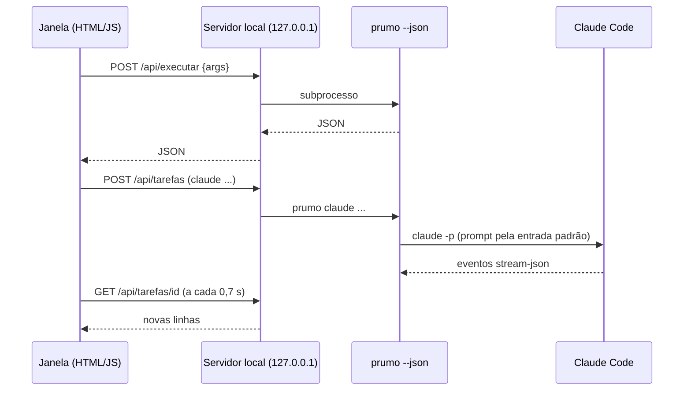

# Interface gráfica

A interface é uma página única em HTML, CSS e JavaScript puros (`prumo_cli/gui/index.html`), sem framework e sem etapa de build. Ela não contém regra de negócio: tudo o que mostra vem dos comandos do Prumo com `--json`.

## Como abrir

- `prumo gui` no terminal, `Start-PrumoGui` no PowerShell ou duplo clique em `prumo-app.exe`.
- A janela abre no Edge ou no Chrome em modo aplicativo (sem barra do navegador). Sem nenhum dos dois, abre no navegador padrão.
- `prumo gui --projeto D:\Projetos\loja` já abre no projeto.
- `prumo gui --sem-janela` só inicia o servidor e mostra o endereço (útil para abrir em outro navegador).

## Para que serve

A interface existe para um fluxo: **criar o projeto → completar a especificação → gerar o kit do Claude → executar**.
Quanto mais a especificação decide, menos o Claude precisa "pensar" na hora de implementar; por isso a tela inicial
de cada projeto mostra a prontidão e o próximo passo, e o kit do Claude tem uma aba própria.

## Telas

| Área | O que tem |
|---|---|
| **Barra lateral** | Novo projeto, busca e lista de projetos recentes (com botão para tirar da lista), abrir pasta, **Meus dados**, paleta de comandos e tema |
| **Visão geral** | Anel de prontidão para executar (documentos completos, validação, aprovação e kit), a jornada em 5 etapas (Criar, Especificar, Validar, Aprovar, Executar) com o próximo passo, indicadores, documentos e resumo do kit |
| **Documentos** | Lista filtrável com o estado de cada documento; visualização com índice das seções, IDs destacados e **diagramas Mermaid desenhados**; **editor embutido** (Ctrl+S salva) com botão **Próxima lacuna**; aprovar/liberar; criar ADR, mudança ou documento do catálogo |
| **Formulário** | Especificação guiada em 5 passos (Negócio, Usuários, Funcionalidades, Integrações, Perguntas), com tabelas editáveis e o preenchimento de cada passo. Grava sozinho em `especificacao.prumo.json` (IDs RF/RN atribuídos ao gravar). **Gravar no briefing** preenche `docs/00-briefing.md` sem apagar o que você ou o Claude escreveram; **Especificar com o Claude** segue para a aba do Claude |
| **Kit do Claude** | Skills, subagentes, hooks (com os eventos em que rodam), `CLAUDE.md`, `AGENTS.md` e `settings.json`, cada um marcado como ok, personalizado, do projeto ou ausente; ver e editar skills e subagentes; regenerar o kit; exportar para Gemini, Copilot e Cursor |
| **Executar com o Claude** | Tarefas agrupadas (Especificar, Executar, Figma, Outro), alvo, instruções, continuar sessão, saída ao vivo, parar e histórico com duração e custo |
| **Qualidade** | Validação (roda ao abrir), varredura de segurança e matriz de rastreabilidade |
| **Gestão** | Orçamento, horas trabalhadas e Figma |
| **Configurações** | Nome, cliente, stack, comandos usados pelos hooks (com os sugeridos pelo perfil), opções dos hooks, modelo do Claude, orçamento do projeto e pastas de código |

Os botões **Pasta**, **VS Code** e **Abrir Claude Code** abrem a pasta do projeto no Explorer, no VS Code ou num terminal já com o `claude` rodando.

O editor só grava Markdown em `docs/`, `.claude/skills/`, `.claude/agents/`, `CLAUDE.md` e `AGENTS.md`. Documentos aprovados
ficam bloqueados até você liberar a edição, e se o arquivo mudou fora da interface desde que foi aberto, ela pede para recarregar em vez de sobrescrever.

## Atalhos

| Atalho | Ação |
|---|---|
| Ctrl+K | Paleta de comandos: abas, documentos, skills, projetos e ações |
| Ctrl+1 … Ctrl+7 | Troca de aba |
| Ctrl+S | Salva o documento em edição |
| F3 ou Ctrl+J | Próxima lacuna `[PREENCHER]` |
| Ctrl+Enter | Envia a tarefa ao Claude |
| Esc | Fecha diálogos |

## Visual

Papel quente, tinta grafite e o verde-petróleo do prumo como cor principal, com terracota de acento. Tema claro, escuro
ou o do sistema (botão **Tema** na barra lateral). Cada estado tem sua cor: verde = completo, âmbar = lacunas,
índigo = aprovado, tijolo = erro.

A paleta é verificada por `tools/cores.py` (também roda nos testes): contraste WCAG AA (texto ≥ 4,5:1, elementos ≥ 3:1)
nos dois temas e cores de estado distinguíveis sob protanopia, deuteranopia e tritanopia (ΔE2000 ≥ 15). Mudou uma cor? Rode:

```
python tools/cores.py
```

Os diagramas usam o [Mermaid](https://mermaid.js.org) embutido em `prumo_cli/gui/mermaid.min.js` (licença MIT em
`mermaid.LICENSE.txt`), sem internet. Ele é servido só com o token da sessão.

## Como funciona



- O servidor escuta só em `127.0.0.1`, numa porta aleatória, e exige um token aleatório gerado a cada abertura (sem ele, a página e a API respondem 403).
- Só os comandos de uma lista fixa podem ser chamados pela interface; a leitura de arquivos fica restrita à pasta do projeto e a extensões de texto, e a gravação às áreas descritas acima.
- Ao fechar a janela, o servidor encerra sozinho em cerca de um minuto (se não houver tarefa do Claude em andamento).
