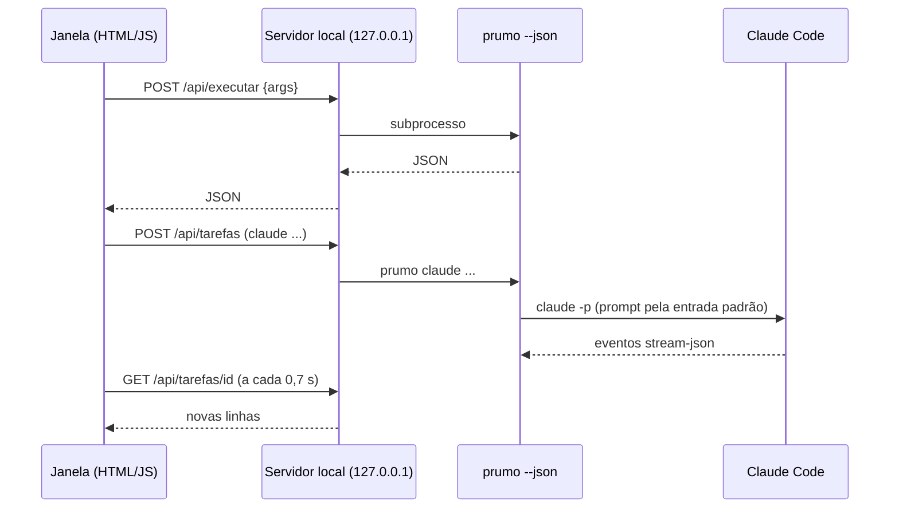

# Interface gráfica

A interface é uma página única em HTML, CSS e JavaScript puros (`prumo_cli/gui/index.html`), sem framework e sem etapa de build. Ela não contém regra de negócio: tudo o que mostra vem dos comandos do Prumo com `--json`.

## Como abrir

- `prumo gui` no terminal, `Start-PrumoGui` no PowerShell ou duplo clique em `prumo-app.exe`.
- A janela abre no Edge ou no Chrome em modo aplicativo (sem barra do navegador). Sem nenhum dos dois, abre no navegador padrão.
- `prumo gui --projeto D:\Projetos\loja` já abre no projeto.
- `prumo gui --sem-janela` só inicia o servidor e mostra o endereço (útil para abrir em outro navegador).

## Telas

| Área | O que tem |
|---|---|
| **Barra lateral** | Novo projeto, projetos recentes, abrir pasta de projeto |
| **Visão geral** | Documentos completos, lacunas, aprovados, itens rastreados, próximo passo e atalhos |
| **Documentos** | Lista com o estado de cada documento; visualização em Markdown com as lacunas destacadas; abrir no editor; aprovar/liberar; criar ADR, mudança ou documento do catálogo |
| **Claude** | Escolha da tarefa (especificar, etapas, implementar, revisar, documentar, segurança, mudança, Figma, pedido livre), alvo, instruções, continuar sessão, saída ao vivo, botão de parar e histórico com duração e custo |
| **Qualidade** | Validação, varredura de segurança e matriz de rastreabilidade |
| **Gestão** | Orçamento (valor da hora e contingência), horas trabalhadas, sincronização com o Figma e exportação para outros agentes |

Os botões **Pasta**, **VS Code** e **Abrir Claude Code** abrem a pasta do projeto no Explorer, no VS Code ou num terminal já com o `claude` rodando.

## Visual

Tons quentes e suaves, cantos arredondados, sombras discretas e transições curtas. O modo escuro segue o sistema operacional (`prefers-color-scheme`).

## Como funciona

- O servidor escuta só em `127.0.0.1`, numa porta aleatória, e exige um token aleatório gerado a cada abertura (sem ele, a página e a API respondem 403).
- Só os comandos de uma lista fixa podem ser chamados pela interface; a leitura de arquivos fica restrita à pasta do projeto e a extensões de texto.
- Ao fechar a janela, o servidor encerra sozinho em cerca de um minuto (se não houver tarefa do Claude em andamento).
