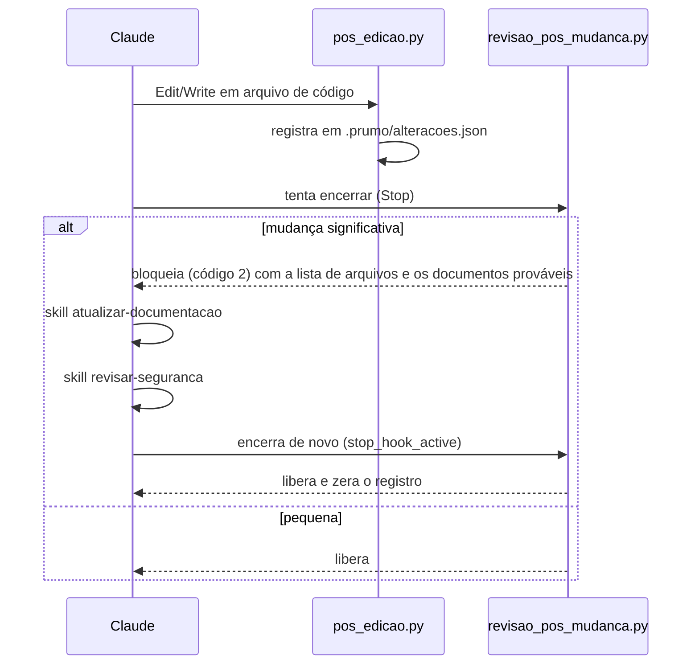

# Segurança e mudanças

## Mudança significativa

Em todo projeto do Prumo, uma mudança significativa obriga duas verificações: **atualizar a documentação afetada** e **procurar falhas de segurança**.

É significativa quando, desde a última verificação, a sessão alterou:

- 3 ou mais arquivos de código (`limite_arquivos`), **ou**
- 80 ou mais linhas (`limite_linhas`), **ou**
- qualquer arquivo de área sensível: autenticação/autorização, banco de dados (migrações, models, schema), rotas/API/middlewares/webhooks, dependências (`package.json`, `requirements.txt`...), infraestrutura (Docker, CI/CD, Terraform), configuração (`.env.example`, `config/`), pagamentos, uploads e criptografia. Acrescente padrões seus em `caminhos_sensiveis`.

Edições só em documentação (`docs/`, `.md`) não contam.

### Como é aplicada

O hook também percebe arquivos alterados por comandos (geradores, migrações) pelo `git status`. A mensagem já sugere os documentos prováveis: migrações → banco de dados e classes; rotas e telas → casos de uso, sequência e interface; dependências → arquitetura; Docker/CI → implantação e entrega; testes → plano de testes.

Desligar (não recomendado): `"revisao_pos_mudanca": false` em `projeto.prumo.json` → `hooks`. Em agentes sem hooks (Codex, Gemini, Copilot, Cursor), a mesma regra está escrita no `AGENTS.md`.

## Revisão de segurança

A skill `revisar-seguranca`:

1. roda `prumo seguranca` (varredura estática; veja [Comandos](comandos.md#prumo-seguranca-arquivos---falhar-em-gravidade)) e a auditoria de dependências da stack (`npm audit`, `pip-audit`, `composer audit`...);
2. revisa à mão os arquivos alterados com o OWASP Top 10: controle de acesso e IDOR, injeção, autenticação, dados pessoais (LGPD), configuração, entrada e uploads, SSRF, segredos e limites de taxa;
3. registra cada achado confirmado como `SEG-00N` em `docs/12-seguranca.md` (gravidade, status, o que afeta, evidência, correção) e acrescenta uma linha ao histórico de revisões;
4. corrige achados locais sem mudar o comportamento especificado e escala os críticos ao usuário.

Para CI: `prumo seguranca --falhar-em Alta`.

## Aprovação e controle de escopo

| Situação | O que fazer |
|---|---|
| Cliente aprovou documentos | `prumo aprovar docs/01-visao.md ...` |
| Pedido novo ou diferente do aprovado | `prumo mudanca "título"` + skill `controle-de-mudancas` (impacto em itens, horas, prazo, custo) |
| Cliente aceitou a mudança | `prumo desaprovar <arquivo>`, atualizar citando o `CM-xxx`, `prumo aprovar <arquivo>` |
| Defeito (o sistema não faz o que foi especificado) | Não é mudança: corrigir |

Proteções: o hook `guarda_arquivos` bloqueia edições de agentes em documentos aprovados e na lista de aprovados; `prumo validar` compara o hash de cada aprovado (ignorando diferenças CRLF/LF do Git no Windows) e acusa alterações feitas por fora.

## Segredos e comandos perigosos

- Agentes não leem nem editam `.env`, `.env.*` (exceto `.env.example`), chaves (`.pem`, `.key`, `.p12`, `id_rsa`...) e arquivos de credenciais.
- Comandos destrutivos ou arriscados são bloqueados pelo `guarda_comandos`. Se um for realmente necessário, o Claude explica e você roda no terminal, ou libera um padrão em `hooks.comandos_permitidos`.
