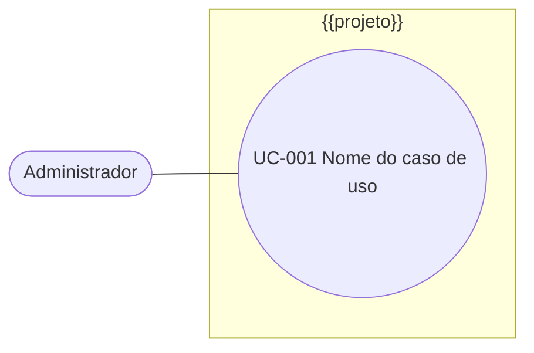

# Casos de Uso — {{projeto}}

| Campo | Valor |
|---|---|
| Versão | 0.1 |
| Data | {{data}} |
| Status | Rascunho |

<!--
Cada caso de uso tem um ID UC-001, UC-002... no título (### UC-001 — Nome).
Dentro do bloco do caso de uso, cite os requisitos (RF/RNF), regras (RN) e telas (TL)
que ele atende: é isso que alimenta a matriz de rastreabilidade (`prumo rastreabilidade`).
Use verbos no infinitivo para o nome: "Cadastrar cliente", "Emitir relatório".
-->

## 1. Atores

| Ator | Tipo | Descrição |
|---|---|---|
| [PREENCHER: Administrador] | Primário | [PREENCHER] |
| [PREENCHER: Gateway de pagamento] | Secundário (sistema) | [PREENCHER] |

## 2. Diagrama de casos de uso

<!-- O Mermaid não tem diagrama de casos de uso nativo; usamos um flowchart com atores à
esquerda e casos de uso (elipses) dentro do limite do sistema. -->

## 3. Especificações

### UC-001 — [PREENCHER: nome do caso de uso]

| Item | Descrição |
|---|---|
| Ator principal | [PREENCHER] |
| Atores secundários | [PREENCHER ou "—"] |
| Requisitos atendidos | RF-001 |
| Regras de negócio | [PREENCHER: RN-xxx ou "—"] |
| Telas | [PREENCHER: TL-xxx, se houver interface, ou "—"] |
| Pré-condições | [PREENCHER] |
| Pós-condições | [PREENCHER] |
| Gatilho | [PREENCHER] |

#### Fluxo principal

1. [PREENCHER: O ator...]
2. [PREENCHER: O sistema...]

#### Fluxos alternativos

- **FA-01 (passo 2):** [PREENCHER]

#### Fluxos de exceção

- **FE-01:** [PREENCHER: o que acontece em caso de erro]
