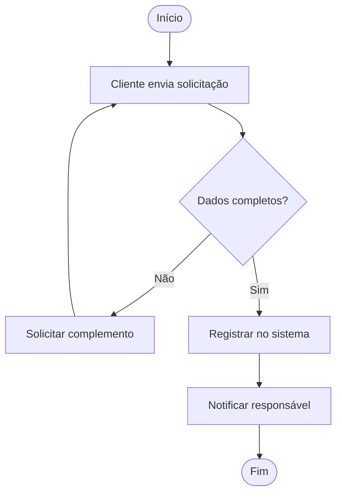

# Diagramas de Atividades (Processos) — {{projeto}}

<!--
Processos de negócio ponta a ponta, incluindo etapas fora do sistema (manuais).
Útil para validar com o cliente o "como funciona hoje" e o "como vai funcionar".
Sintaxe: https://mermaid.js.org/syntax/flowchart.html
-->

## Processo — [PREENCHER: nome do processo]

[PREENCHER: responsáveis por etapa, SLAs, pontos de automação]
