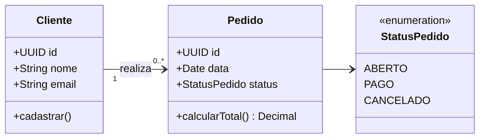

# Diagrama de Classes (Modelo de Domínio) — {{projeto}}

<!--
Modele as entidades do domínio e seus relacionamentos a partir dos casos de uso
(substantivos recorrentes = candidatos a classe; verbos = candidatos a operação).
Mantenha coerência com 06-banco-de-dados.md quando houver persistência.
Sintaxe: https://mermaid.js.org/syntax/classDiagram.html
-->

## 1. Diagrama

<!-- prumo:gerado:diagrama -->

<!-- prumo:gerado:fim -->

## 2. Responsabilidades

<!-- prumo:gerado:responsabilidades -->
| Classe | Responsabilidade | Casos de uso relacionados |
|---|---|---|
| [PREENCHER] | [PREENCHER] | [PREENCHER: UC-xxx] |
<!-- prumo:gerado:fim -->

## 3. Observações de projeto

[PREENCHER: invariantes, agregados, value objects, decisões de modelagem]
