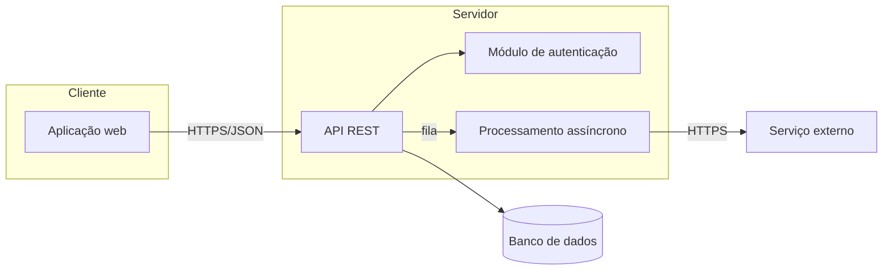

# Diagrama de Componentes — {{projeto}}

<!--
Visão estrutural: aplicações, serviços, módulos internos e integrações externas,
com o protocolo de cada ligação. Deve bater com 07-arquitetura.md.
-->

## 1. Componentes e dependências

## 2. Descrição

| Componente | Responsabilidade | Tecnologia |
|---|---|---|
| [PREENCHER] | [PREENCHER] | [PREENCHER] |
