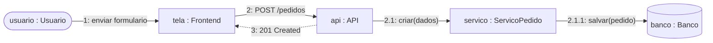

# Diagramas de Comunicação — {{projeto}}

<!--
Mesma interação de um diagrama de sequência, mas com foco nos vínculos entre objetos.
Use quando importa "quem fala com quem" (acoplamento), não a linha do tempo. Mensagens numeradas (1, 1.1, 2...).
Título de cada seção: "## Comunicação — UC-001 Nome". Sintaxe: flowchart com rótulos nas arestas.
-->

## Comunicação — UC-001 [PREENCHER: nome]

[PREENCHER: notas sobre acoplamento ou objetos com muitos vínculos]
