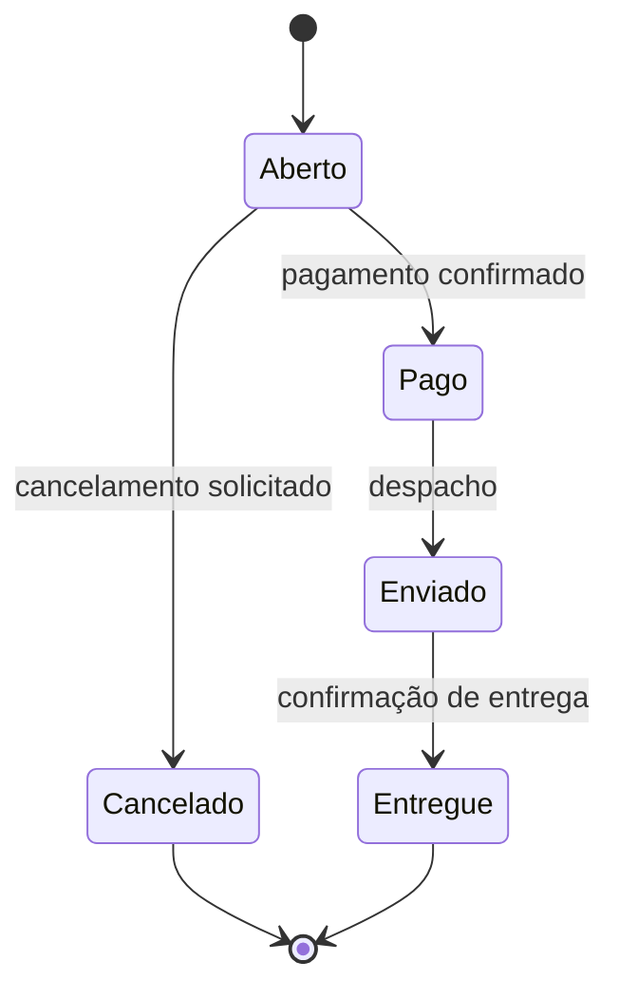

# Diagramas de Estados — {{projeto}}

<!--
Para entidades com ciclo de vida (pedido, chamado, assinatura, pagamento...).
Cada transição deve corresponder a um passo de caso de uso ou regra de negócio (RN).
Sintaxe: https://mermaid.js.org/syntax/stateDiagram.html
-->

## Estados — [PREENCHER: entidade]

| Transição | Gatilho | Regra de negócio |
|---|---|---|
| [PREENCHER] | [PREENCHER] | [PREENCHER: RN-xxx] |
