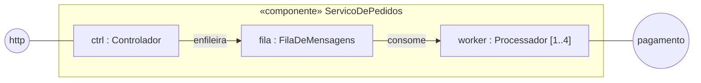

# Diagrama de Estrutura Composta — {{projeto}}

<!--
Estrutura interna de um componente/classe complexo: partes, portas (pontos de interação) e conectores.
Use para os componentes de componentes.md que têm partes internas relevantes (ex.: serviço com fila e workers).
Notação: subgraph = classificador; nós = partes ("nome : Tipo"); círculos = portas.
-->

## Estrutura interna — [PREENCHER: componente]

| Parte / porta | Tipo | Multiplicidade | Interface oferecida/requerida |
|---|---|---|---|
| [PREENCHER] | [PREENCHER] | [PREENCHER] | [PREENCHER] |
