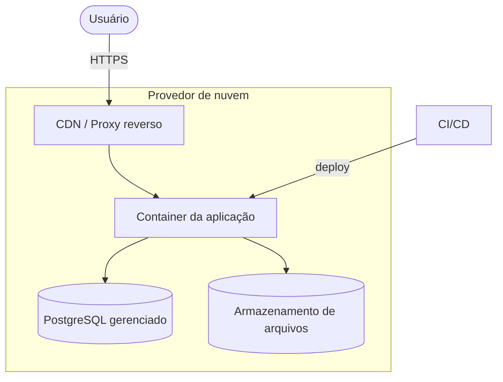

# Diagrama de Implantação — {{projeto}}

<!--
Onde cada componente roda em produção: provedores, containers, domínios, CDN,
banco gerenciado, filas, armazenamento de arquivos, e como o deploy acontece.
-->

## 1. Ambiente de produção

## 2. Ambientes

| Ambiente | URL | Infraestrutura | Observações |
|---|---|---|---|
| Desenvolvimento | localhost | [PREENCHER] | |
| Homologação | [PREENCHER] | [PREENCHER] | Validação com o cliente |
| Produção | [PREENCHER] | [PREENCHER] | |
