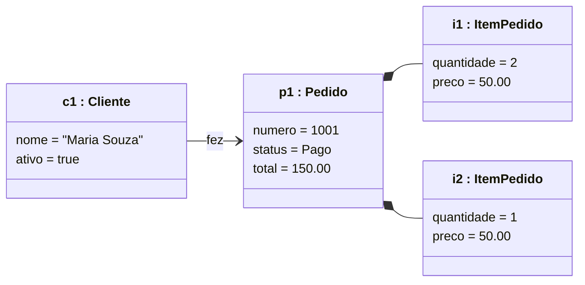

# Diagrama de Objetos — {{projeto}}

<!--
Um retrato do modelo de classes num instante: instâncias concretas com valores, para validar
multiplicidades e regras de negócio (RN) com exemplos reais antes de codificar. Use os nomes de classes.md.
Notação: "nome : Classe"; atributos com valores. Sintaxe: classDiagram com rótulos (https://mermaid.js.org/syntax/classDiagram.html)
-->

## Cenário — [PREENCHER: situação de exemplo, ex.: pedido pago com dois itens] (UC-001)

| Objeto | Regra verificada |
|---|---|
| [PREENCHER: p1] | [PREENCHER: RN-xxx — total = soma dos itens] |
