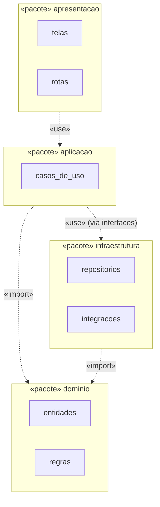

# Diagrama de Pacotes — {{projeto}}

<!--
Organização lógica do código em pacotes/módulos e as dependências permitidas entre eles.
Deve bater com a estrutura de pastas e os módulos de 07-arquitetura.md: é a regra de "quem pode importar quem".
Dependência = seta tracejada com «import» ou «use». Ciclos entre pacotes são proibidos.
-->

## 1. Pacotes e dependências

## 2. Regras de dependência

| Pacote | Pasta | Pode depender de | Não pode depender de |
|---|---|---|---|
| [PREENCHER: dominio] | [PREENCHER: src/dominio] | nada | [PREENCHER: infraestrutura, apresentacao] |
