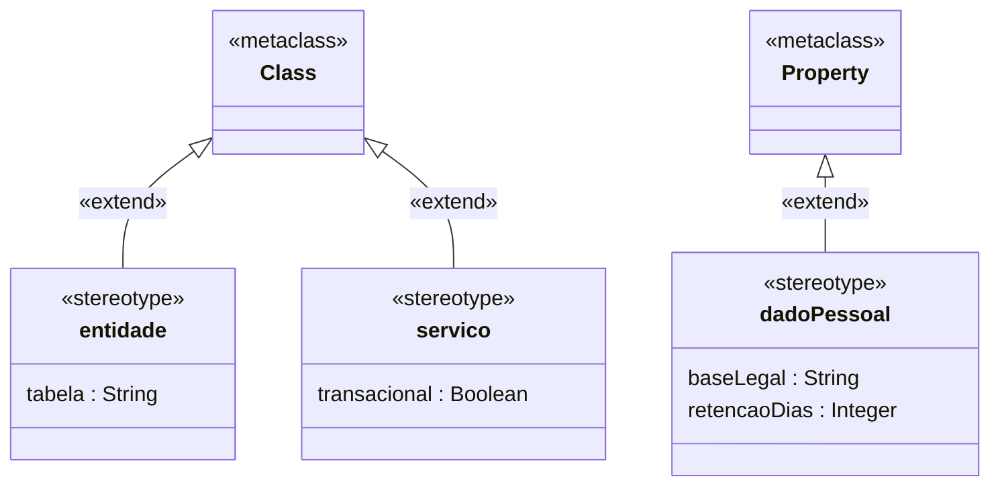

# Perfil UML (estereótipos) — {{projeto}}

<!--
Extensões da UML usadas nos diagramas deste projeto: estereótipos, valores etiquetados e restrições.
Serve de vocabulário comum entre diagramas e código (ex.: toda classe «entidade» vira tabela em 06-banco-de-dados.md;
todo atributo «dadoPessoal» entra no inventário LGPD). Defina só o que for usado.
Notação: «metaclass» estendida pelo estereótipo (seta com rótulo «extend»).
-->

## 1. Estereótipos

## 2. Dicionário

| Estereótipo | Aplica-se a | Valores etiquetados | Significado / regra no código |
|---|---|---|---|
| «entidade» | Classe | tabela | [PREENCHER: persistida; tem tabela em 06-banco-de-dados.md] |
| «servico» | Classe | transacional | [PREENCHER: regra de negócio sem estado] |
| «dadoPessoal» | Atributo | baseLegal, retencaoDias | [PREENCHER: LGPD; mascarar em logs (12-seguranca.md)] |
