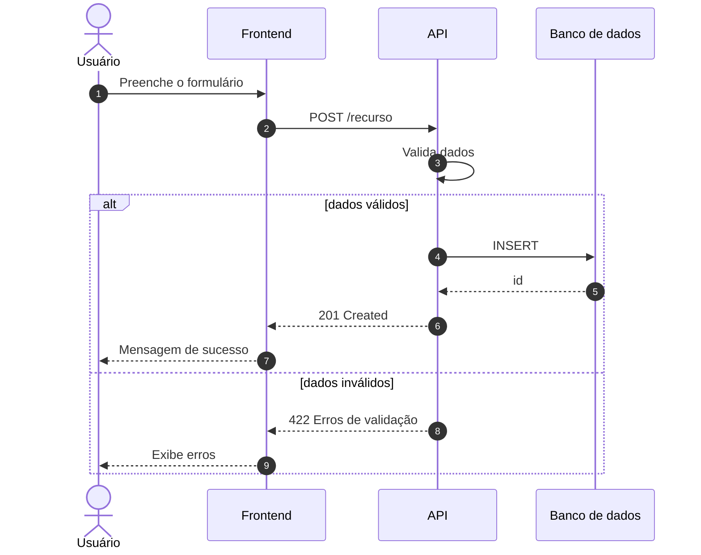

# Diagramas de Sequência — {{projeto}}

<!--
Um diagrama por caso de uso relevante (fluxo principal + exceções importantes).
Título de cada seção: "## Sequência — UC-001 Nome". Participantes reais da arquitetura
(Frontend, API, Serviço, Banco, sistemas externos).
Sintaxe: https://mermaid.js.org/syntax/sequenceDiagram.html
-->

## Sequência — UC-001 [PREENCHER: nome]

[PREENCHER: notas sobre transações, idempotência, timeouts]
