# Diagramas de Tempo — {{projeto}}

<!--
Mudanças de estado ao longo do tempo, com prazos e restrições temporais (timeouts, SLAs, expiração, polling, agendamentos).
Use para requisitos de desempenho (RNF) e regras com prazo (RN). A Mermaid não tem diagrama de tempo UML:
a tabela é a fonte de verdade; o gantt (eixo em segundos) é a visualização. Uma linha do gantt por estado de cada linha de vida.
-->

## Tempo — [PREENCHER: interação, ex.: pagamento com timeout] (RNF-001)

| Instante (s) | Linha de vida | Estado / evento | Restrição |
|---|---|---|---|
| 0 | Pedido | Aguardando pagamento | — |
| 0 | Gateway | Processando | resposta em até 30 s |
| 30 | Pedido | Expirado (se sem resposta) | [PREENCHER: RN-xxx] |

```mermaid
gantt
    title Pedido e gateway (segundos)
    dateFormat X
    axisFormat %S
    section Pedido
    Aguardando pagamento :a1, 0, 30s
    Expirado             :a2, after a1, 10s
    section Gateway
    Processando          :b1, 0, 30s
    Timeout              :milestone, b2, after b1, 0s
```

