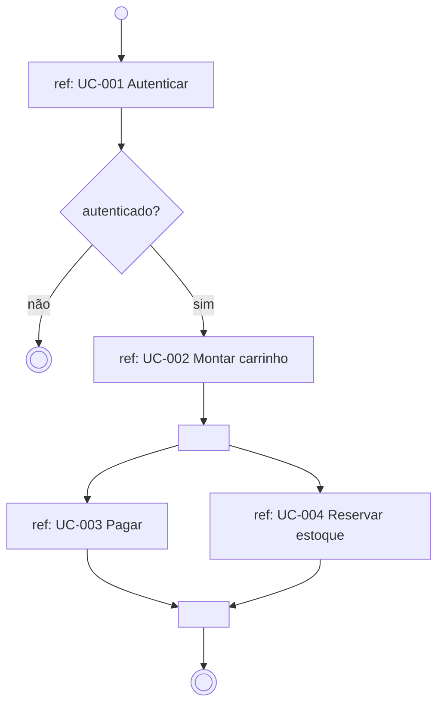

# Visão Geral de Interação — {{projeto}}

<!--
Fluxo de controle entre interações: cada nó "ref" aponta para um diagrama de sequência (sequencia.md) ou de comunicação.
Mostra a jornada completa (ordem dos casos de uso, decisões, paralelismo) sem repetir os detalhes de cada interação.
Sintaxe: flowchart; nós "ref" em retângulos, decisões em losango, paralelismo com fork/join.
-->

## Jornada — [PREENCHER: nome, ex.: compra completa]

| Nó | Diagrama detalhado |
|---|---|
| [PREENCHER: UC-001] | [PREENCHER: sequencia.md — Sequência — UC-001] |
