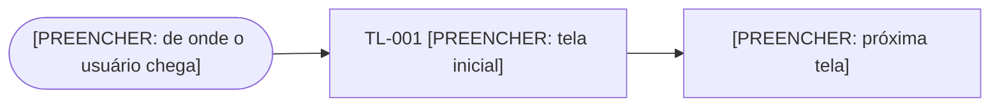

# Interface e Protótipos — {{projeto}}

<!--
Liga as telas do Figma aos casos de uso. Fluxo recomendado:
1. Informe o arquivo do Figma em projeto.prumo.json ("figma": {"arquivo": "<url>"})
   ou passe a URL no comando.
2. Rode `prumo figma telas` para preencher o inventário abaixo (precisa da variável
   de ambiente FIGMA_TOKEN com um token pessoal do Figma).
3. Preencha a coluna "Casos de uso" de cada tela. Ela é preservada nas sincronizações.
Na implementação, a skill `implementar-tela-figma` usa o servidor MCP do Figma
para ler o design de cada tela.
-->

## 1. Design system

<!-- prumo:gerado:design-system -->
| Item | Valor |
|---|---|
| Arquivo do Figma | [PREENCHER: URL] |
| Biblioteca de componentes | [PREENCHER: shadcn/ui, MUI, Tailwind, próprio...] |
| Tipografia | [PREENCHER] |
| Paleta / tokens | [PREENCHER: variáveis do Figma ou tokens CSS] |
| Breakpoints | [PREENCHER: ex.: 640 / 768 / 1024 / 1280 px] |
<!-- prumo:gerado:fim -->

## 2. Inventário de telas

<!-- prumo:figma:inicio -->
| ID | Tela | Página do Figma | Link | Casos de uso | Imagem |
|---|---|---|---|---|---|
| TL-001 | [PREENCHER: nome da tela] | — | [PREENCHER: link do frame] | UC-001 | — |
<!-- prumo:figma:fim -->

## 3. Mapa de navegação

<!-- Substitua pelo mapa real: um nó por tela do inventário e as entradas externas (anúncio, link, e-mail). -->

<!-- prumo:gerado:navegacao -->

<!-- prumo:gerado:fim -->

## 4. Telas

<!-- Uma subseção por tela, com título "### Tela TL-00N — Nome" (o ID é definido no inventário acima). -->

<!-- prumo:gerado:telas -->
### Tela TL-001 — [PREENCHER: nome]

- **Objetivo:** [PREENCHER]
- **Conteúdo, na ordem:** [PREENCHER: blocos da tela]
- **Ações:** [PREENCHER: botões e formulários e para onde levam]
- **Estados:** [PREENCHER: vazio, carregando, erro, sucesso, quando se aplicam]
- **Atende:** [PREENCHER: RF/RNF/UC]
<!-- prumo:gerado:fim -->

## 5. Diretrizes

- **Acessibilidade:** [PREENCHER: contraste WCAG AA, navegação por teclado, rótulos em formulários]
- **Responsividade:** [PREENCHER: dispositivos prioritários]
- **Estados de tela:** vazio, carregando, erro e sucesso para cada listagem e formulário.
- **Textos:** [PREENCHER: tom de voz, quem fornece os textos finais]
