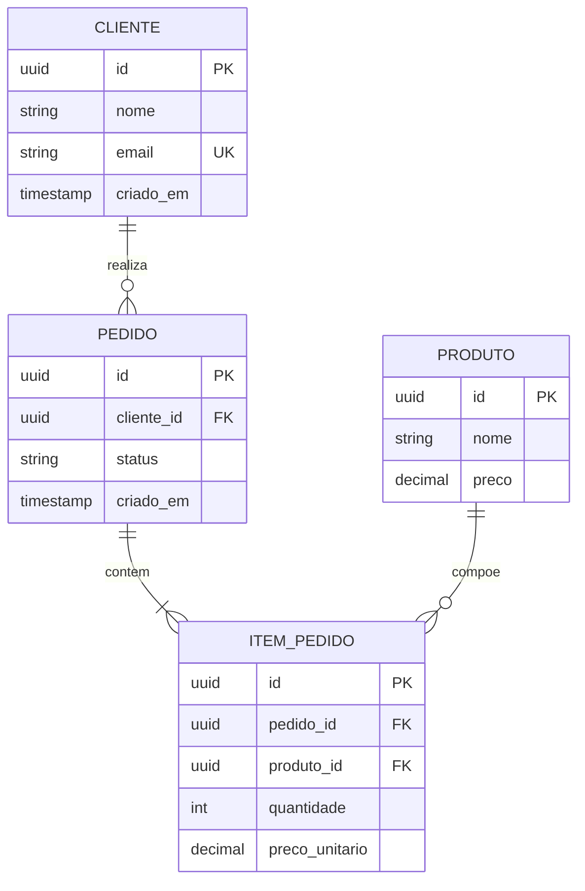

# Modelo de Dados — {{projeto}}

<!-- prumo:gerado:cabecalho -->
| Campo | Valor |
|---|---|
| SGBD | [PREENCHER: PostgreSQL 16, MySQL 8, SQLite...] |
| ORM / migrações | [PREENCHER: Prisma, Drizzle, SQLAlchemy + Alembic, EF Core...] |
| Convenção de nomes | snake_case, tabelas no singular, chave primária `id` |
| Versão | 0.1 |
<!-- prumo:gerado:fim -->

<!--
Derive as entidades do diagrama de classes (04-uml/classes.md).
Todo campo pessoal deve aparecer na seção de privacidade (LGPD).
Seções 5 a 7 são curtas em projetos pequenos: uma linha "não se aplica" basta.
Sintaxe do diagrama: https://mermaid.js.org/syntax/entityRelationshipDiagram.html
-->

## 1. Diagrama entidade-relacionamento

<!-- prumo:gerado:er -->

<!-- prumo:gerado:fim -->

## 2. Dicionário de dados

<!-- prumo:gerado:dicionario -->
### Tabela `[PREENCHER: nome]`

| Coluna | Tipo | Nulo | Padrão | Restrições | Descrição |
|---|---|---|---|---|---|
| id | uuid | não | gen_random_uuid() | PK | Identificador |
| [PREENCHER] | | | | | |
<!-- prumo:gerado:fim -->

## 3. Índices e restrições

| Tabela | Índice / restrição | Colunas | Motivo |
|---|---|---|---|
| [PREENCHER] | [PREENCHER] | [PREENCHER] | [PREENCHER: consulta do UC-xxx] |

## 4. DDL de referência

```sql
-- [PREENCHER] Gerado/atualizado a partir do diagrama acima.
-- As migrações oficiais ficam no código (pasta de migrações do ORM).
```

## 5. Volume e consultas críticas

| Tabela | Linhas hoje | Crescimento | Consulta crítica | Meta | Origem |
|---|---|---|---|---|---|
| [PREENCHER] | [PREENCHER] | [PREENCHER: por mês] | [PREENCHER: filtro/ordenação] | [PREENCHER: p95 < 200 ms] | [PREENCHER: UC-xxx / RNF-xxx] |

<!-- Confira cada consulta crítica com EXPLAIN (ANALYZE) antes de entregar; o índice correspondente vai na seção 3. -->

## 6. Cargas e integrações de dados

| Origem → destino | Frequência | Volume | Chave de deduplicação | Tratamento de erro |
|---|---|---|---|---|
| [PREENCHER: planilha/API/sistema → tabela] | [PREENCHER] | [PREENCHER] | [PREENCHER] | [PREENCHER: rejeitados vão para tabela de quarentena] |

## 7. Papéis e acesso ao banco

| Papel | Quem usa | Permissões | Observação |
|---|---|---|---|
| app | aplicação | SELECT, INSERT, UPDATE, DELETE nas tabelas do sistema | sem DDL |
| migracao | ferramenta de migrações / CI | DDL | só no deploy |
| leitura | relatórios / BI | SELECT (de preferência em views) | sem dados pessoais desnecessários |

## 8. Privacidade e retenção (LGPD)

<!-- prumo:gerado:lgpd -->
| Dado pessoal | Tabela.coluna | Finalidade | Base legal | Retenção | Proteção |
|---|---|---|---|---|---|
| E-mail | cliente.email | [PREENCHER] | [PREENCHER] | [PREENCHER] | [PREENCHER] |
<!-- prumo:gerado:fim -->

## 9. Migrações, seeds e backup

- **Migrações:** [PREENCHER: ferramenta, como rodar, política de rollback]. Mudança que quebra compatibilidade segue expandir → migrar dados → contrair, em deploys separados.
- **Dados iniciais (seeds):** [PREENCHER]
- **Backup:** [PREENCHER: frequência, retenção, teste de restauração]
- **Objetivos de recuperação:** [PREENCHER: RPO (perda máxima aceitável) e RTO (tempo para voltar)]
