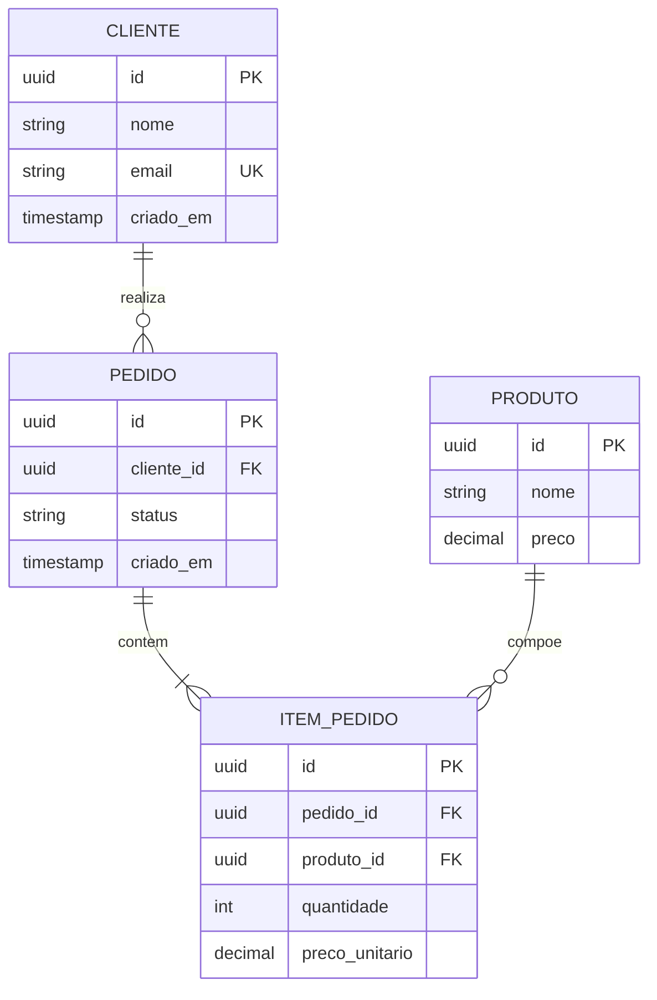

# Modelo de Dados — {{projeto}}

| Campo | Valor |
|---|---|
| SGBD | [PREENCHER: PostgreSQL 16, MySQL 8, SQLite...] |
| ORM / migrações | [PREENCHER: Prisma, Drizzle, SQLAlchemy + Alembic, EF Core...] |
| Convenção de nomes | snake_case, tabelas no singular, chave primária `id` |
| Versão | 0.1 |

<!--
Derive as entidades do diagrama de classes (04-uml/classes.md).
Todo campo pessoal deve aparecer na seção de privacidade (LGPD).
Sintaxe do diagrama: https://mermaid.js.org/syntax/entityRelationshipDiagram.html
-->

## 1. Diagrama entidade-relacionamento



## 2. Dicionário de dados

### Tabela `[PREENCHER: nome]`

| Coluna | Tipo | Nulo | Padrão | Restrições | Descrição |
|---|---|---|---|---|---|
| id | uuid | não | gen_random_uuid() | PK | Identificador |
| [PREENCHER] | | | | | |

## 3. Índices e restrições

| Tabela | Índice / restrição | Colunas | Motivo |
|---|---|---|---|
| [PREENCHER] | [PREENCHER] | [PREENCHER] | [PREENCHER: consulta do UC-xxx] |

## 4. DDL de referência

```sql
-- [PREENCHER] Gerado/atualizado a partir do diagrama acima.
-- As migrações oficiais ficam no código (pasta de migrações do ORM).
```

## 5. Privacidade e retenção (LGPD)

| Dado pessoal | Tabela.coluna | Finalidade | Base legal | Retenção | Proteção |
|---|---|---|---|---|---|
| E-mail | cliente.email | [PREENCHER] | [PREENCHER] | [PREENCHER] | [PREENCHER] |

## 6. Migrações, seeds e backup

- **Migrações:** [PREENCHER: ferramenta, como rodar, política de rollback]
- **Dados iniciais (seeds):** [PREENCHER]
- **Backup:** [PREENCHER: frequência, retenção, teste de restauração]
