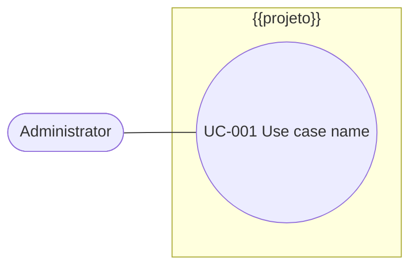

# Use Cases — {{projeto}}

| Field | Value |
|---|---|
| Version | 0.1 |
| Date | {{data}} |
| Status | Draft |

<!--
Each use case has an ID UC-001, UC-002... in the heading (### UC-001 — Name).
Inside the use case block, cite the requirements (RF/RNF), rules (RN) and screens (TL)
it covers: that is what feeds the traceability matrix (`prumo rastreabilidade`).
Use verbs for the name: "Register customer", "Issue report".
-->

## 1. Actors

<!-- prumo:gerado:atores -->
| Actor | Type | Description |
|---|---|---|
| [FILL: Administrator] | Primary | [FILL] |
| [FILL: Payment gateway] | Secondary (system) | [FILL] |
<!-- prumo:gerado:fim -->

## 2. Use case diagram

<!-- Mermaid has no native use case diagram; we use a flowchart with actors on the
left and use cases (ellipses) inside the system boundary. -->

<!-- prumo:gerado:diagrama -->

<!-- prumo:gerado:fim -->

## 3. Specifications

<!-- prumo:gerado:especificacoes -->
### UC-001 — [FILL: use case name]

| Item | Description |
|---|---|
| Primary actor | [FILL] |
| Secondary actors | [FILL or "—"] |
| Requirements covered | RF-001 |
| Business rules | [FILL: RN-xxx or "—"] |
| Screens | [FILL: TL-xxx, if there is an interface, or "—"] |
| Preconditions | [FILL] |
| Postconditions | [FILL] |
| Trigger | [FILL] |

#### Main flow

1. [FILL: The actor...]
2. [FILL: The system...]

#### Alternative flows

- **AF-01 (step 2):** [FILL]

#### Exception flows

- **EF-01:** [FILL: what happens on error]
<!-- prumo:gerado:fim -->
