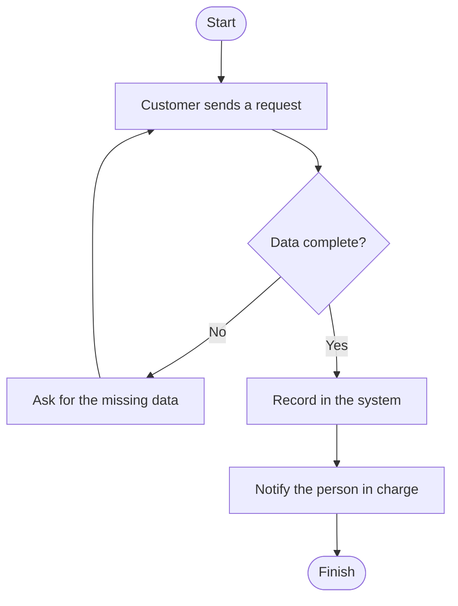

# Activity Diagrams (Processes) — {{projeto}}

<!--
End-to-end business processes, including steps outside the system (manual ones).
Useful to validate with the client "how it works today" and "how it will work".
Syntax: https://mermaid.js.org/syntax/flowchart.html
-->

## Process — [FILL: process name]

[FILL: owner of each step, SLAs, automation points]
