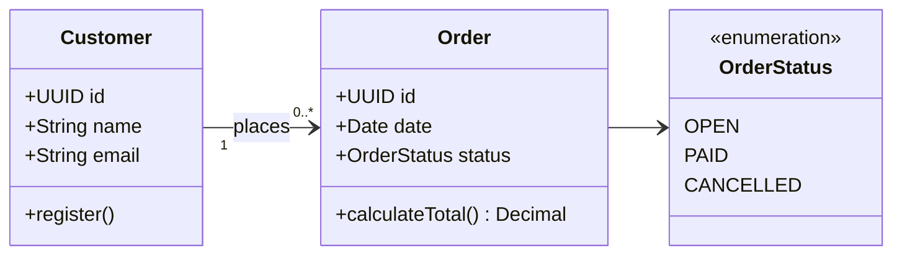

# Class Diagram (Domain Model) — {{projeto}}

<!--
Model the domain entities and their relationships from the use cases
(recurring nouns = class candidates; verbs = operation candidates).
Keep it consistent with 06-banco-de-dados.md when there is persistence.
Syntax: https://mermaid.js.org/syntax/classDiagram.html
-->

## 1. Diagram

<!-- prumo:gerado:diagrama -->

<!-- prumo:gerado:fim -->

## 2. Responsibilities

<!-- prumo:gerado:responsabilidades -->
| Class | Responsibility | Related use cases |
|---|---|---|
| [FILL] | [FILL] | [FILL: UC-xxx] |
<!-- prumo:gerado:fim -->

## 3. Design notes

[FILL: invariants, aggregates, value objects, modeling decisions]
