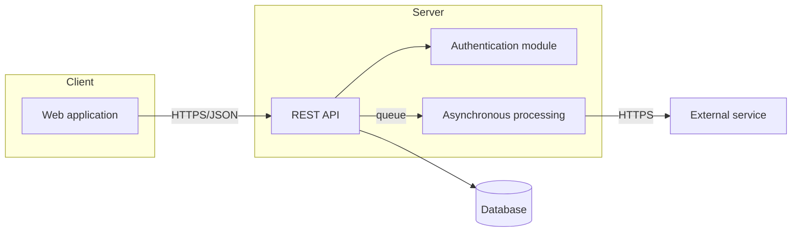

# Component Diagram — {{projeto}}

<!--
Structural view: applications, services, internal modules and external integrations,
with the protocol of each link. Must match 07-arquitetura.md.
-->

## 1. Components and dependencies

## 2. Description

| Component | Responsibility | Technology |
|---|---|---|
| [FILL] | [FILL] | [FILL] |
