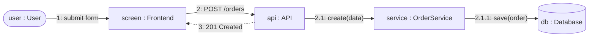

# Communication Diagrams — {{projeto}}

<!--
The same interaction as a sequence diagram, but focused on the links between objects.
Use it when "who talks to whom" (coupling) matters, not the timeline. Numbered messages (1, 1.1, 2...).
Title of each section: "## Communication — UC-001 Name". Syntax: flowchart with edge labels.
-->

## Communication — UC-001 [FILL: name]

[FILL: notes on coupling or objects with many links]
