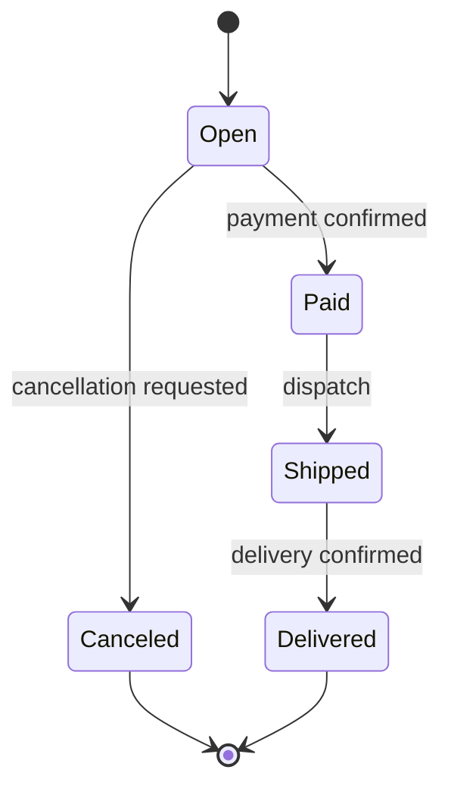

# State Diagrams — {{projeto}}

<!--
For entities with a lifecycle (order, ticket, subscription, payment...).
Each transition must match a use case step or a business rule (RN).
Syntax: https://mermaid.js.org/syntax/stateDiagram.html
-->

## States — [FILL: entity]

| Transition | Trigger | Business rule |
|---|---|---|
| [FILL] | [FILL] | [FILL: RN-xxx] |
