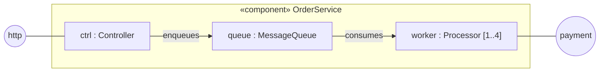

# Composite Structure Diagram — {{projeto}}

<!--
Internal structure of a complex component or class: parts, ports (interaction points) and connectors.
Use it for the components in componentes.md that have relevant internal parts (e.g. a service with a queue and workers).
Notation: subgraph = classifier; nodes = parts ("name : Type"); circles = ports.
-->

## Internal structure — [FILL: component]

| Part / port | Type | Multiplicity | Provided/required interface |
|---|---|---|---|
| [FILL] | [FILL] | [FILL] | [FILL] |
