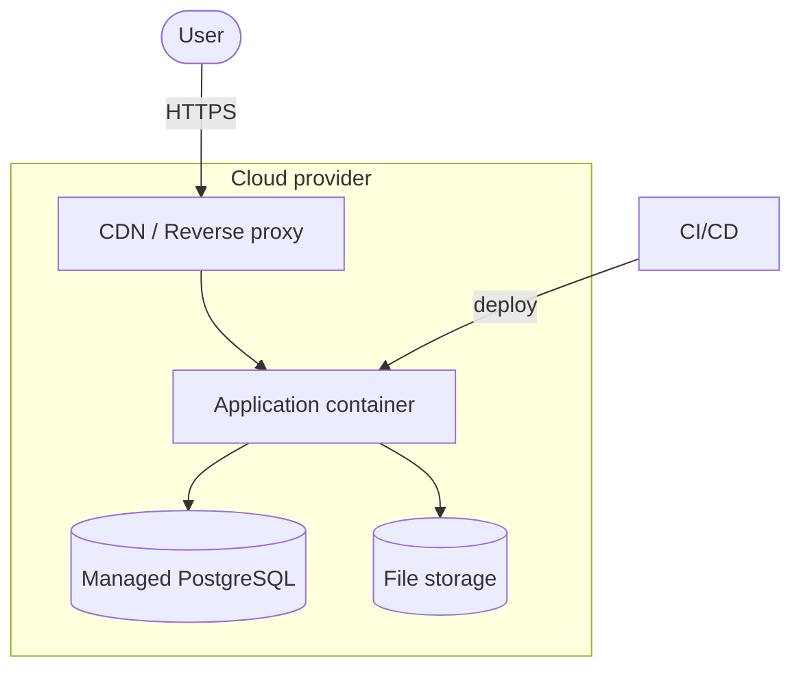

# Deployment Diagram — {{projeto}}

<!--
Where each component runs in production: providers, containers, domains, CDN,
managed database, queues, file storage, and how deployment happens.
-->

## 1. Production environment

## 2. Environments

| Environment | URL | Infrastructure | Notes |
|---|---|---|---|
| Development | localhost | [FILL] | |
| Staging | [FILL] | [FILL] | Client validation |
| Production | [FILL] | [FILL] | |
