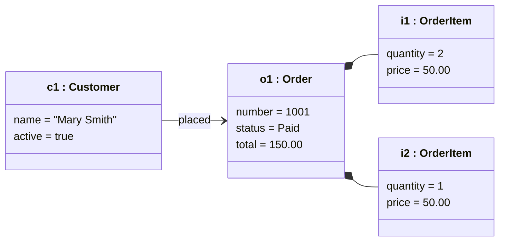

# Object Diagram — {{projeto}}

<!--
A snapshot of the class model at one moment: concrete instances with values, to validate
multiplicities and business rules (RN) with real examples before coding. Use the names from classes.md.
Notation: "name : Class"; attributes with values. Syntax: classDiagram with labels (https://mermaid.js.org/syntax/classDiagram.html)
-->

## Scenario — [FILL: sample situation, e.g. paid order with two items] (UC-001)

| Object | Rule checked |
|---|---|
| [FILL: o1] | [FILL: RN-xxx — total = sum of the items] |
