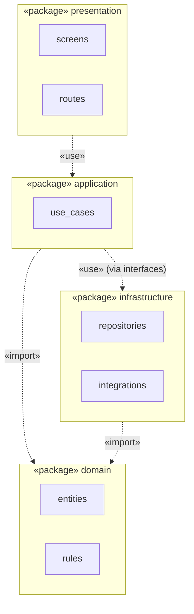

# Package Diagram — {{projeto}}

<!--
Logical organization of the code into packages/modules and the allowed dependencies between them.
It must match the folder structure and the modules in 07-arquitetura.md: it is the "who may import whom" rule.
Dependency = dashed arrow with «import» or «use». Cycles between packages are forbidden.
-->

## 1. Packages and dependencies

## 2. Dependency rules

| Package | Folder | May depend on | Must not depend on |
|---|---|---|---|
| [FILL: domain] | [FILL: src/domain] | nothing | [FILL: infrastructure, presentation] |
