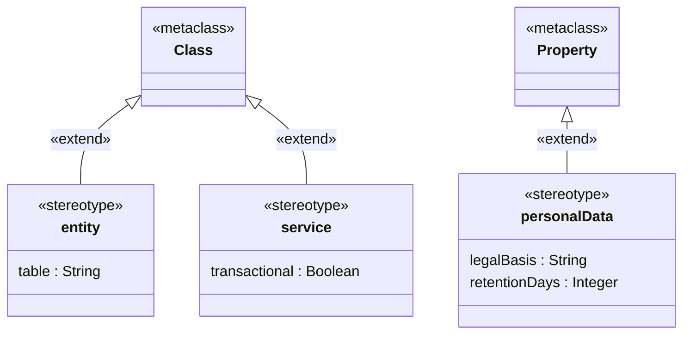

# UML Profile (stereotypes) — {{projeto}}

<!--
UML extensions used in this project's diagrams: stereotypes, tagged values and constraints.
It is the shared vocabulary between diagrams and code (e.g. every «entity» class becomes a table in 06-banco-de-dados.md;
every «personalData» attribute goes into the privacy inventory). Define only what is used.
Notation: «metaclass» extended by the stereotype (arrow labeled «extend»).
-->

## 1. Stereotypes

## 2. Dictionary

| Stereotype | Applies to | Tagged values | Meaning / rule in the code |
|---|---|---|---|
| «entity» | Class | table | [FILL: persisted; has a table in 06-banco-de-dados.md] |
| «service» | Class | transactional | [FILL: stateless business rule] |
| «personalData» | Attribute | legalBasis, retentionDays | [FILL: privacy law; mask in logs (12-seguranca.md)] |
