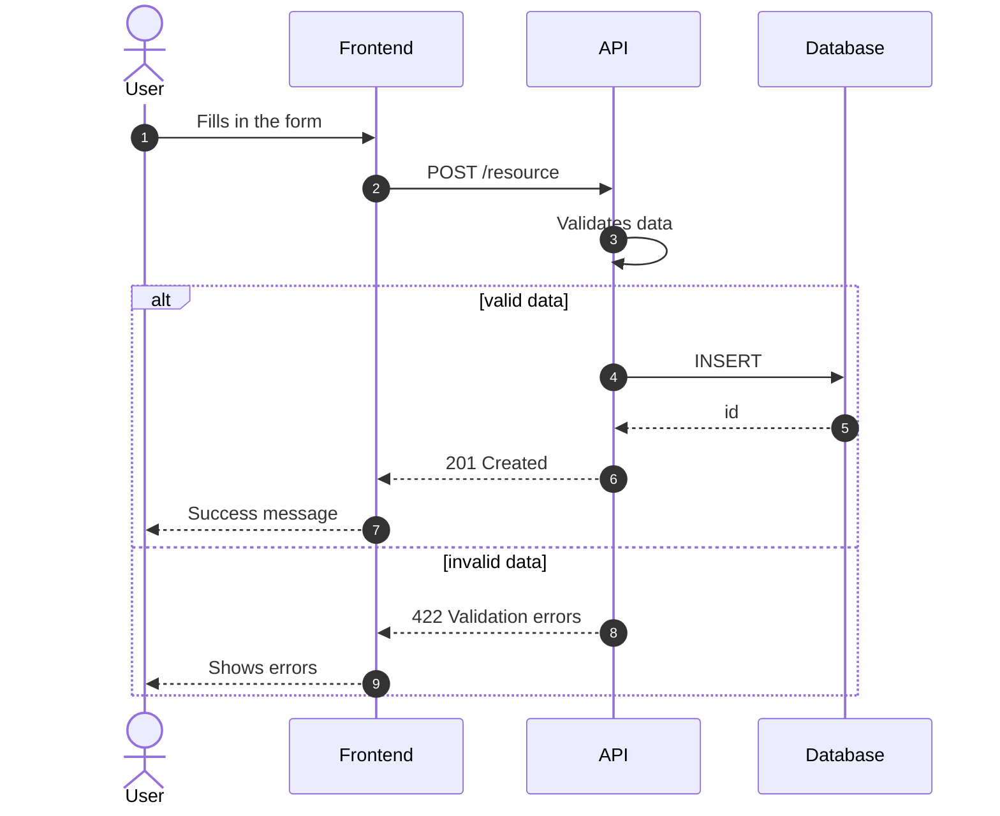

# Sequence Diagrams — {{projeto}}

<!--
One diagram per relevant use case (main flow + important exceptions).
Title of each section: "## Sequence — UC-001 Name". Real participants from the architecture
(Frontend, API, Service, Database, external systems).
Syntax: https://mermaid.js.org/syntax/sequenceDiagram.html
-->

## Sequence — UC-001 [FILL: name]

[FILL: notes on transactions, idempotency, timeouts]
