# Timing Diagrams — {{projeto}}

<!--
State changes over time, with deadlines and timing constraints (timeouts, SLAs, expiration, polling, schedules).
Use it for performance requirements (RNF) and rules with deadlines (RN). Mermaid has no UML timing diagram:
the table is the source of truth; the gantt (axis in seconds) is the visualization. One gantt row per state of each lifeline.
-->

## Timing — [FILL: interaction, e.g. payment with timeout] (RNF-001)

| Instant (s) | Lifeline | State / event | Constraint |
|---|---|---|---|
| 0 | Order | Awaiting payment | — |
| 0 | Gateway | Processing | response within 30 s |
| 30 | Order | Expired (if no response) | [FILL: RN-xxx] |

```mermaid
gantt
    title Order and gateway (seconds)
    dateFormat X
    axisFormat %S
    section Order
    Awaiting payment :a1, 0, 30s
    Expired          :a2, after a1, 10s
    section Gateway
    Processing       :b1, 0, 30s
    Timeout          :milestone, b2, after b1, 0s
```

