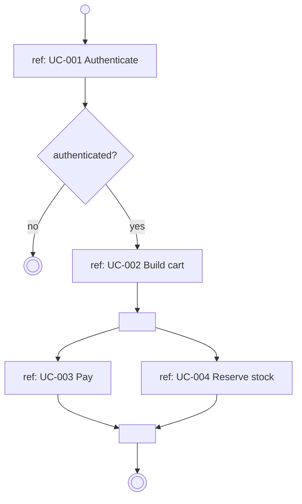

# Interaction Overview — {{projeto}}

<!--
Control flow between interactions: each "ref" node points to a sequence diagram (sequencia.md) or a communication diagram.
It shows the full journey (order of use cases, decisions, parallelism) without repeating the details of each interaction.
Syntax: flowchart; "ref" nodes in rectangles, decisions in diamonds, parallelism with fork/join.
-->

## Journey — [FILL: name, e.g. full purchase]

| Node | Detailed diagram |
|---|---|
| [FILL: UC-001] | [FILL: sequencia.md — Sequence — UC-001] |
