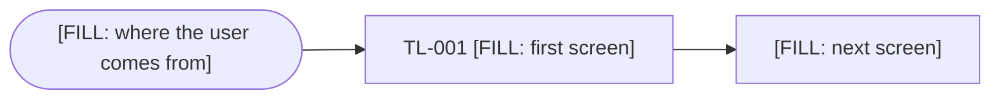

# Interface and Prototypes — {{projeto}}

<!--
Links the Figma screens to the use cases. Recommended flow:
1. Set the Figma file in projeto.prumo.json ("figma": {"arquivo": "<url>"})
   or pass the URL in the command.
2. Run `prumo figma telas` to fill in the inventory below (needs the FIGMA_TOKEN
   environment variable with a Figma personal token).
3. Fill in the "Use cases" column of each screen. It is kept across syncs.
During implementation, the `implementar-tela-figma` skill uses the Figma MCP server
to read the design of each screen.
-->

## 1. Design system

| Item | Value |
|---|---|
| Figma file | [FILL: URL] |
| Component library | [FILL: shadcn/ui, MUI, Tailwind, custom...] |
| Typography | [FILL] |
| Palette / tokens | [FILL: Figma variables or CSS tokens] |
| Breakpoints | [FILL: e.g. 640 / 768 / 1024 / 1280 px] |

## 2. Screen inventory

<!-- prumo:figma:inicio -->
| ID | Screen | Figma page | Link | Use cases | Image |
|---|---|---|---|---|---|
| TL-001 | [FILL: screen name] | — | [FILL: frame link] | UC-001 | — |
<!-- prumo:figma:fim -->

## 3. Navigation map

<!-- Replace with the real map: one node per inventory screen plus the external entries (ad, link, email). -->

## 4. Screens

<!-- One subsection per screen, titled "### Screen TL-00N — Name" (the ID is defined in the inventory above). -->

### Screen TL-001 — [FILL: name]

- **Goal:** [FILL]
- **Content, in order:** [FILL: screen blocks]
- **Actions:** [FILL: buttons and forms and where they lead]
- **States:** [FILL: empty, loading, error, success, when they apply]
- **Covers:** [FILL: RF/RNF/UC]

## 5. Guidelines

- **Accessibility:** [FILL: WCAG AA contrast, keyboard navigation, form labels]
- **Responsiveness:** [FILL: priority devices]
- **Screen states:** empty, loading, error and success for every list and form.
- **Copy:** [FILL: tone of voice, who provides the final texts]
