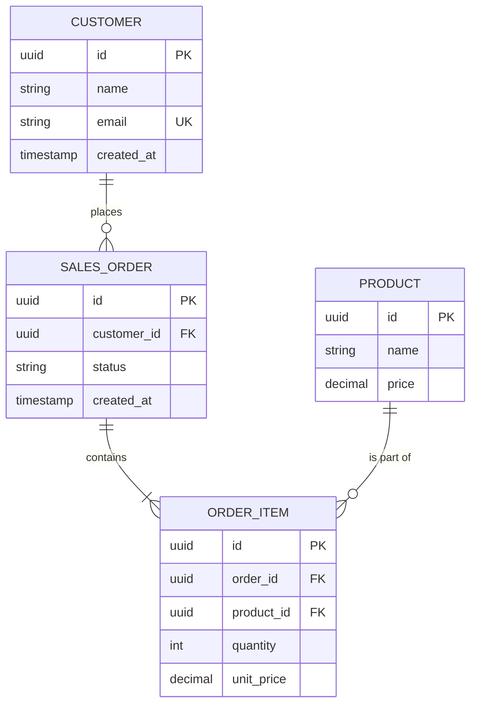

# Data Model — {{projeto}}

| Field | Value |
|---|---|
| DBMS | [FILL: PostgreSQL 16, MySQL 8, SQLite...] |
| ORM / migrations | [FILL: Prisma, Drizzle, SQLAlchemy + Alembic, EF Core...] |
| Naming convention | snake_case, singular table names, primary key `id` |
| Version | 0.1 |

<!--
Derive the entities from the class diagram (04-uml/classes.md).
Every personal field must appear in the privacy section.
Sections 5 to 7 are short in small projects: a "not applicable" line is enough.
Diagram syntax: https://mermaid.js.org/syntax/entityRelationshipDiagram.html
-->

## 1. Entity-relationship diagram



## 2. Data dictionary

### Table `[FILL: name]`

| Column | Type | Null | Default | Constraints | Description |
|---|---|---|---|---|---|
| id | uuid | no | gen_random_uuid() | PK | Identifier |
| [FILL] | | | | | |

## 3. Indexes and constraints

| Table | Index / constraint | Columns | Reason |
|---|---|---|---|
| [FILL] | [FILL] | [FILL] | [FILL: query of UC-xxx] |

## 4. Reference DDL

```sql
-- [FILL] Generated/updated from the diagram above.
-- The official migrations live in the code (the ORM's migrations folder).
```

## 5. Volume and critical queries

| Table | Rows today | Growth | Critical query | Target | Source |
|---|---|---|---|---|---|
| [FILL] | [FILL] | [FILL: per month] | [FILL: filter/sort] | [FILL: p95 < 200 ms] | [FILL: UC-xxx / RNF-xxx] |

<!-- Check each critical query with EXPLAIN (ANALYZE) before delivery; the matching index goes in section 3. -->

## 6. Data loads and integrations

| Source → target | Frequency | Volume | Deduplication key | Error handling |
|---|---|---|---|---|
| [FILL: spreadsheet/API/system → table] | [FILL] | [FILL] | [FILL] | [FILL: rejected rows go to a quarantine table] |

## 7. Database roles and access

| Role | Used by | Permissions | Note |
|---|---|---|---|
| app | application | SELECT, INSERT, UPDATE, DELETE on the system tables | no DDL |
| migration | migration tool / CI | DDL | only on deploy |
| read | reports / BI | SELECT (preferably on views) | no unnecessary personal data |

## 8. Privacy and retention (LGPD/GDPR)

| Personal data | Table.column | Purpose | Legal basis | Retention | Protection |
|---|---|---|---|---|---|
| Email | customer.email | [FILL] | [FILL] | [FILL] | [FILL] |

## 9. Migrations, seeds and backup

- **Migrations:** [FILL: tool, how to run them, rollback policy]. A breaking change follows expand → migrate data → contract, in separate deploys.
- **Initial data (seeds):** [FILL]
- **Backup:** [FILL: frequency, retention, restore test]
- **Recovery objectives:** [FILL: RPO (maximum acceptable loss) and RTO (time to recover)]
